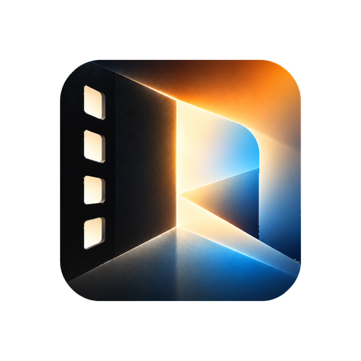
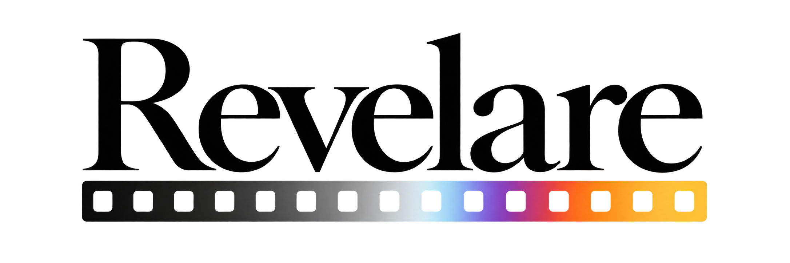
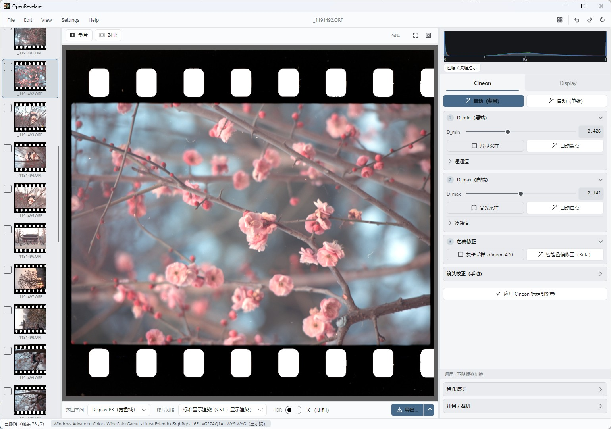
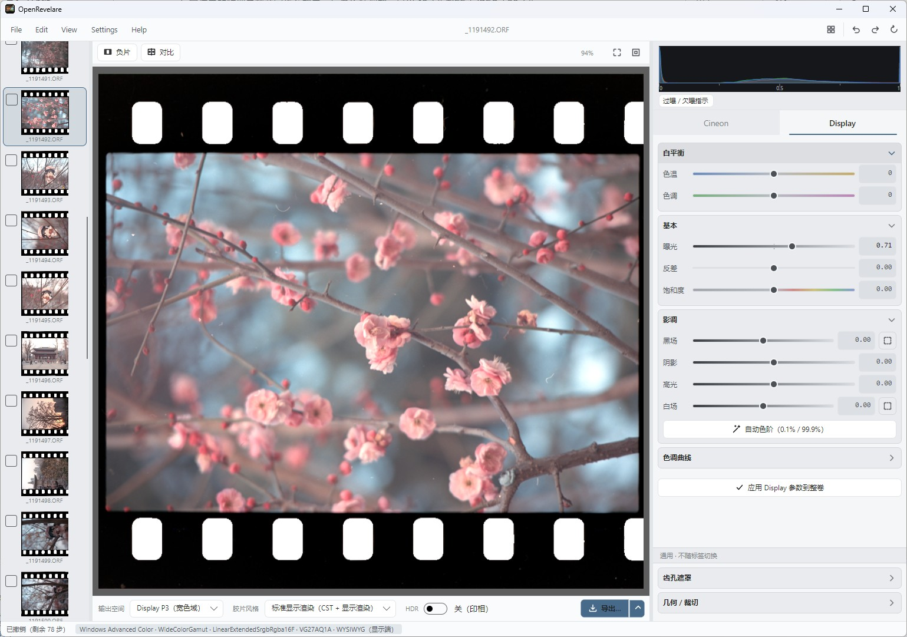
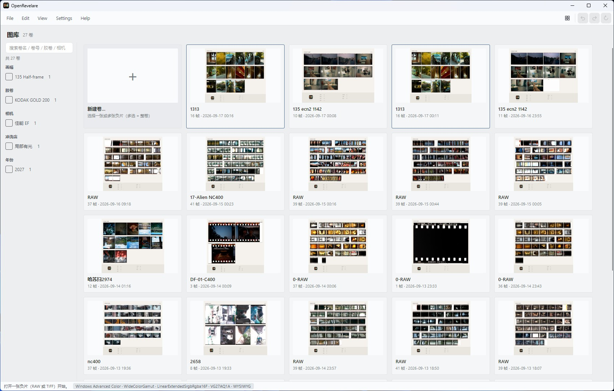
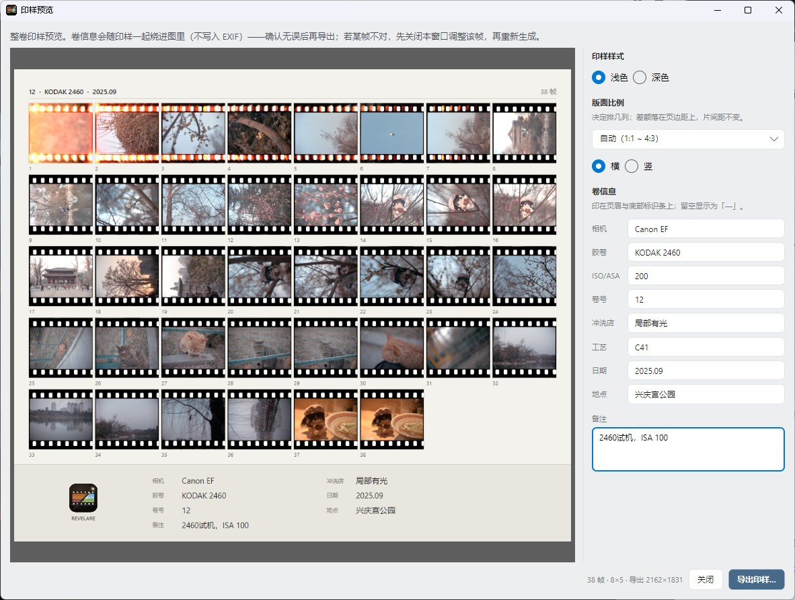
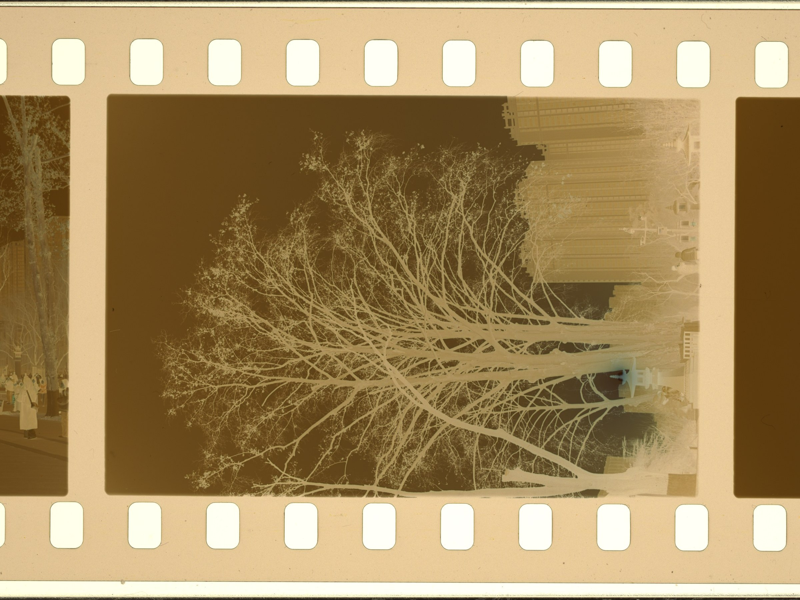
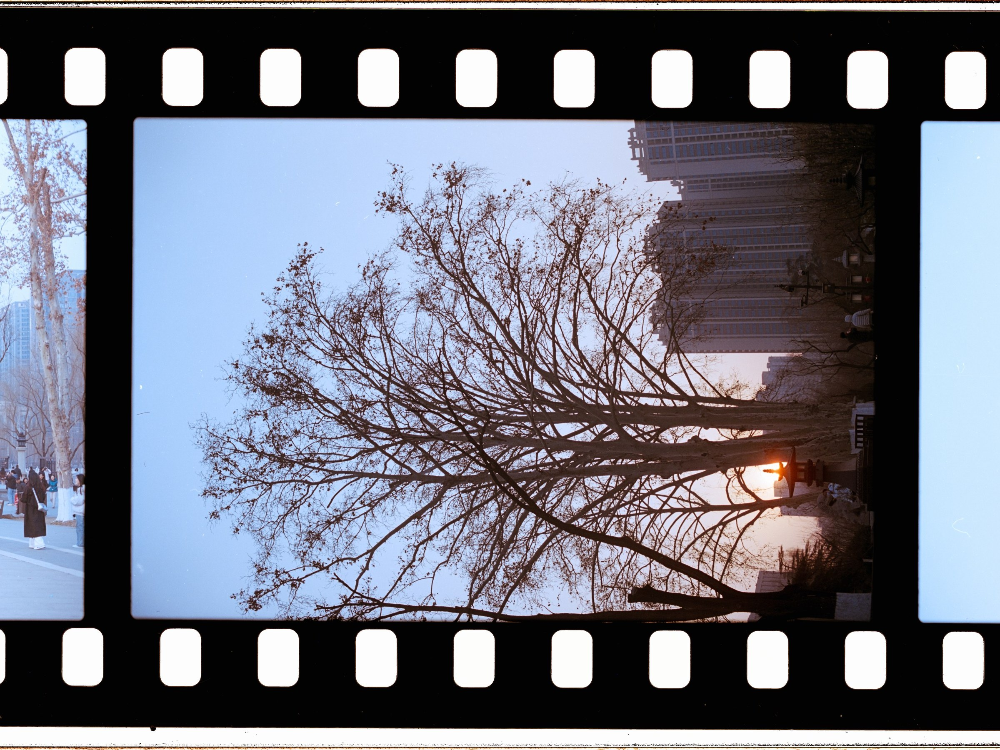
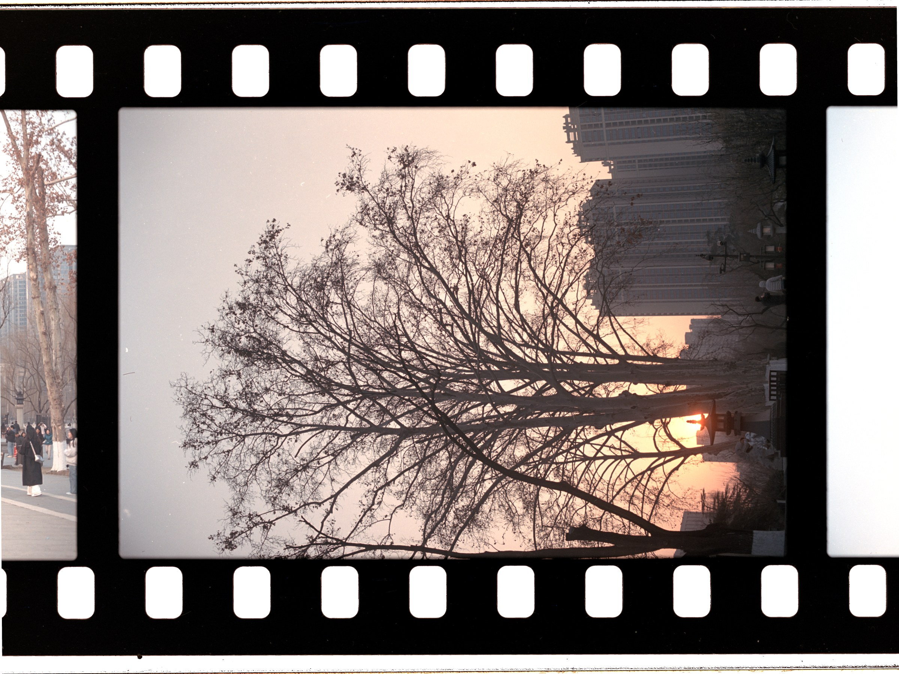

<p align="center">
  
</p>

<h1 align="center">OpenRevelare</h1>

<p align="center">
  
</p>

<p align="center"><b>An open-source digital darkroom for film negatives</b><br>Turn camera-scanned RAW and scanner TIFF files into positives, one roll at a time.</p>

<p align="center">
  <a href="https://github.com/Toshihiko-Lin/Open-Revelare/releases/latest"></a>
  <a href="https://github.com/Toshihiko-Lin/Open-Revelare/releases/latest"></a>
  <a href="https://github.com/Toshihiko-Lin/Open-Revelare/releases/latest"></a>
</p>

<p align="center">
  <a href="https://github.com/Toshihiko-Lin/Open-Revelare/releases/latest"></a>
  <a href="https://github.com/Toshihiko-Lin/Open-Revelare/actions/workflows/ci.yml"></a>
  <a href="LICENSE"></a>
</p>

<p align="center"><a href="#overview">English</a> · <a href="README.zh-CN.md">简体中文</a></p>

<p align="center">
  <a href="#installation">Download</a> · <a href="#workflow">First roll</a> · <a href="#overview">Overview</a> ·
  <a href="#interface-and-examples">Interface</a> · <a href="#features">Features</a> ·
  <a href="#documentation">Documentation</a> · <a href="#building-from-source">Build</a> · <a href="#licence-and-third-party-components">Licence</a>
</p>

---

## Overview

New users can start with [Your first roll](src/OpenRevelare.Gui/Assets/docs/FIRST-ROLL.en.md), also available offline in Help → documentation → First roll.

OpenRevelare is a standalone desktop application for photographers who digitise film with a camera or scanner. Import a roll, share its base calibration across frames, make individual edits and export your photographs. No subscription or host photo editor is required.

Colour negatives contain an orange base and dye layers. OpenRevelare linearises the input, removes the base, white-balances and inverts it in the Cineon log-density domain, then exports a positive.

- **Explainable**: base, maximum density and channel-balance parameters have defined meanings.
- **Reproducible**: settings are stored in a `.ncproj` beside the image; source files remain untouched.
- **Local-first**: image processing works offline without an account. Update checks and optional model downloads use the network. The inversion pipeline runs in the shared CPU Core; supported Windows/macOS systems can accelerate selected resizing, sharpening and LUT operations on the GPU.
- **Cross-platform**: C# / .NET 8 + Avalonia for Windows, Linux and macOS.

The application is intended for whole-roll camera-copy and scanning workflows, archival parameters and reproducible reprocessing. HDR editing and export are supported; Linux currently keeps the on-screen preview on an explicitly labelled SDR fallback. It does not provide per-roll colour-chart calibration; use [DiVERE](https://github.com/flipswitchingmonkey/DiVERE) for heritage, commercial-archive or research work that requires it.

## Installation

Packages are published on [Releases](https://github.com/Toshihiko-Lin/Open-Revelare/releases/latest) with the .NET runtime included.

| Platform | Package | Status and requirements |
|---|---|---|
| Windows 10/11 x64 | `setup.exe` | Stable; no additional dependency |
| Linux x86_64 | `.AppImage` | Beta; glibc ≥ 2.35 |
| macOS Apple Silicon | `-arm64.dmg` | Beta; macOS 12+, no real-device validation yet |
| macOS Intel | `-x86_64.dmg` | Beta; macOS 12+, no real-device validation yet |

<details>
<summary>Platform notes</summary>

- **Windows**: if SmartScreen appears, select **More info → Run anyway**.
- **macOS**: approve the first launch under **System Settings → Privacy & Security → Open Anyway**, or run:

  ```bash
  xattr -dr com.apple.quarantine /Applications/OpenRevelare.app
  ```

- **Linux**:

  ```bash
  chmod +x OpenRevelare-*.AppImage && ./OpenRevelare-*.AppImage
  ```

  Add `--appimage-extract-and-run` if the package cannot start directly. Linux currently previews through SDR; HDR editing and export remain available.

</details>

## Model

| Stage | Scope | Responsibility |
|---|---|---|
| **FilmBase** | Whole roll | Base transmittance, maximum density, channel balance and inversion parameters |
| **SceneBase** | Single frame | Temperature, exposure, contrast, saturation and curves |

The separation allows physical parameters to be shared across a roll while frame-level edits remain independent.

### Principles

1. **The mask is physical**: measure the base; do not replace measurement with visual guessing.
2. **Density is the computation domain**: the mask is approximately a constant offset, making white balance and inversion predictable.
3. **Restoration and creation are separate**: FilmBase provides consistency; SceneBase provides expression.

## Workflow

1. **Import** RAW, scanner TIFF or another supported image and enter roll metadata.
2. **Calibrate the roll**: estimate the base, white balance, shadow endpoint and `d_max`; correct manually when required.
3. **Apply FilmBase** to the roll or selected frames.
4. **Edit frames** in SceneBase with temperature, exposure, contrast, saturation and curves.
5. **Export** TIFF, JPEG, HEIC, linear DNG or scene-linear ACEScg TIFF. Start with an sRGB JPEG for sharing, or a 16-bit TIFF for further editing.

Changes are written automatically. The `.ncproj` is placed beside the source when that directory is writable; read-only media use the per-user `rolls` fallback shown below.

## Interface and examples

### Cineon calibration

<p align="center"></p>
<p align="center"><sub>Roll thumbnails, the current frame and shared physical parameters on one page.</sub></p>

### Display adjustment

<p align="center"></p>
<p align="center"><sub>Frame-level creative adjustments without changing FilmBase.</sub></p>

<table>
  <tr>
    <td width="50%"></td>
    <td width="50%"></td>
  </tr>
  <tr>
    <td align="center"><sub>Roll management, filtering and project recovery</sub></td>
    <td align="center"><sub>Full-roll contact sheet with sprocket layout and metadata</sub></td>
  </tr>
</table>

### Reversal result

<table>
  <tr>
    <td width="33%"></td>
    <td width="33%"></td>
    <td width="33%"></td>
  </tr>
  <tr>
    <td align="center"><sub>Raw input</sub></td>
    <td align="center"><sub>NLP automatic reversal</sub></td>
    <td align="center"><sub>OpenRevelare result</sub></td>
  </tr>
</table>

## Features

| Category | Capabilities |
|---|---|
| Reversal | Cineon density-domain inversion, auto-calibration, narrow-band light decoupling (Path A), black-and-white negatives |
| Colour | ACEScg workspace; sRGB, Display P3 and Adobe RGB output; exact ICC management; Stage 2 controls |
| Pre-processing | LCC flat-field, offline Lensfun lens matching, distortion and vignetting correction, sprocket masking and geometry crop in linear light |
| Auto crop | [135 positive / negative auto crop](docs/auto-crop-135.md): content 3:2 and 35 mm border 37:35 modes, small-angle straightening, one crop scale and pixel ratio across the roll |
| Workflow | Roll management, roll sync, virtual copies, format presets, 80-step undo/redo, histogram and waveform |
| Output | 16-bit TIFF, JPEG, 10-bit HEIC, linear DNG, 32-bit float scene-linear ACEScg TIFF and HDR gain-map JPEG; templates, scaling and sharpening |
| Look / HDR | Cineon-input `.cube` print looks, SDR/HDR roll rendering, HDR limit in stops, HDR contact sheets; direct PQ or Adaptive HDR HEIC (viewer support required) |
| Reports | Per-frame report of input domain, base source and inversion parameters |

Inputs include DNG, NEF, CR2/CR3, ARW, RAF, RW2, ORF, PEF, IIQ, Hasselblad/Flextight `.fff` and TIFF. JPEG/PNG are export or cache formats, not negative-input formats. RAW file-dialog filters accept upper- and lower-case extensions.

## How it works

Transmittance `T` is converted to log density:

$$D = -\log_{10}(T)$$

The core operations are:

$$T_{norm} = T / T_{base}$$

$$D_{corr}[c] = D[c] \times w_{high}[c] + w_{offset}[c]$$

$$T_{pos} = 10^{\left(\frac{R_{out}}{D_{max}[c]}D[c]-R_{out}\right)}$$

The per-frame pipeline is: linearisation → optical correction → optional light-source decoupling → base removal → density-domain white balance → inversion → output. The application includes the complete derivation under **Help → Operation guide / Technical theory**.

## Data locations

| Content | Windows | Linux / macOS |
|---|---|---|
| Settings and roll index | `%APPDATA%\OpenRevelare` | `$XDG_CONFIG_HOME/OpenRevelare/` (default `~/.config`) |
| Contact-sheet cache | `%LOCALAPPDATA%\OpenRevelare\sheets` | `$XDG_CACHE_HOME/OpenRevelare/sheets/` (default `~/.cache`) |
| DNG decode cache | `.revelare-cache/` beside the source | Same |
| Print LUT drop-in folder | `%LOCALAPPDATA%\OpenRevelare\luts` | `$XDG_DATA_HOME/OpenRevelare/luts/` (default `~/.local/share`) |
| Project file | `.ncproj` beside the source when writable; otherwise `%APPDATA%\OpenRevelare\rolls` | Beside the source when writable; otherwise `$XDG_CONFIG_HOME/OpenRevelare/rolls/` |

Cache locations and limits are configurable. Uninstalling does not remove these data.

## Documentation

- [Your first roll](src/OpenRevelare.Gui/Assets/docs/FIRST-ROLL.en.md): import, calibration, editing, export and reopening a project.
- [Operation guide](src/OpenRevelare.Gui/Assets/docs/GUIDE.en.md): controls and everyday workflows.
- [Technical theory](src/OpenRevelare.Gui/Assets/docs/THEORY.en.md): the colour and inversion model.
- [Changelog](CHANGELOG.md): release history and improvements.
- [Contributing](CONTRIBUTING.md) · [Security policy](SECURITY.md) · [Third-party notices](THIRD_PARTY_NOTICES.txt).

## Frequently asked questions

**Can I import JPEG or PNG negatives?** No. Use a supported RAW file or TIFF; 16-bit TIFF is preferable to 8-bit for shadow detail.

**Do edits change my originals?** No. Edits are stored in `.ncproj` project files. For a complete backup, retain the originals, projects, LUTs and calibration references together; an exported TIFF does not replace them.

**Why does HDR look different in another app?** HDR display depends on the operating system, display and viewer. Linux uses an SDR preview fallback. Check a sample export in your intended viewer before exporting the full roll.

**Is Smart Cast Correction required?** No. Deep-WB is optional and downloaded separately after licence acceptance. Its CC BY-NC-SA 4.0 non-commercial licence differs from the application's GPL licence; review [model licensing](models/README.md) before use.

## Building from source

Requires .NET 8 SDK, Python 3.12+, CMake 3.21+ and a C/C++ toolchain (Visual Studio 2022 C++ on Windows, Xcode command-line tools on macOS, GCC/Clang on Linux). x64 HEIC builds also require NASM 2.13+ on PATH. The first native build downloads checksum-pinned dependencies.

Clone the repository:

```bash
git clone https://github.com/Toshihiko-Lin/Open-Revelare.git
cd Open-Revelare
```

Build native dependencies on **Windows (PowerShell)**:

```powershell
./packaging/lcms/build-windows.ps1
./packaging/libraw/build-windows.ps1
python packaging/compute/build.py
python packaging/heif/build.py
./packaging/windows/build-win32-presenter.ps1
```

On **Linux / macOS**:

```bash
bash packaging/lcms/build-unix.sh
bash packaging/libraw/build-unix.sh
python3 packaging/compute/build.py
python3 packaging/heif/build.py
```

Then build, test and run:

```bash
dotnet build -c Release -warnaserror
dotnet test -c Release --no-build
dotnet run --project src/OpenRevelare.Gui -c Release
```

[LibRaw](packaging/libraw/README.md) · [Little CMS](packaging/lcms/README.md) · [HEIC](packaging/heif/README.md) · [GPU compute](packaging/compute/README.md). See [RELEASE.md](RELEASE.md) for platform packaging and release checks.

CLI example:

```bash
dotnet run --project src/OpenRevelare.Cli -- -i neg.tiff -o pos.tiff --input-linear --color-space sRGB
```

`--input-linear` and `--input-srgb` are mutually exclusive input declarations. Legacy `--d-max`,
`--grade`, `--pivot` and `--scan-exposure-ev` are accepted for old parity scripts but are no-ops;
the current inversion is controlled by the two calibrated density endpoints and output range.

Read [CONTRIBUTING.md](CONTRIBUTING.md) before development. Calibration experiments are documented in [`docs/calibration/`](docs/calibration/); colour-management decisions are recorded in [`docs/color-management-architecture.md`](docs/color-management-architecture.md).

## Licence and third-party components

The code is licensed under **GPL-3.0-only**; see [LICENSE](LICENSE).

Optional automatic dust detection integrates MIT-licensed engine code from [PURE Neg](https://github.com/easonzhangbin/PURENeg), maintained by easonzhangbin, and its underlying [film-dust engine](https://github.com/magholmes/film-dust) by Magnus Holmes. OpenRevelare uses a pinned revision of its [integration fork](https://github.com/Toshihiko-Lin/PURENeg); component scope, revisions and licence notices are documented in [THIRD_PARTY_NOTICES.txt](THIRD_PARTY_NOTICES.txt).

Deep-WB is an optional download: accept the license when first using Smart Cast Correction, or run `OpenRevelare.Cli --install-deep-wb`. Default packages do not include model weights. Downloads automatically fall back to the [Gitee mirror](https://gitee.com/Toshihiko-Lin/openrevelare-models/releases/download/deep-wb-v1/net_awb.onnx) if GitHub fails; offline installation is also supported. The ONNX runtime remains bundled.

`models/net_awb.onnx` is the Deep White-Balance Editing model, distributed under **CC BY-NC-SA 4.0** and outside this project's GPL scope. See [models/README.md](models/README.md) and [THIRD_PARTY_NOTICES.txt](THIRD_PARTY_NOTICES.txt).

References include [LightSourceDecouple](https://github.com/karasuyasabou/LightSourceDecouple), [DiVERE](https://github.com/flipswitchingmonkey/DiVERE) and darktable `negadoctor`.

## Project origin and acknowledgements

Special thanks to **[easonzhangbin and the PURE Neg contributors](https://github.com/easonzhangbin/PURENeg)** for sharing the film-cleaning work behind OpenRevelare's automatic dust detection, and to **[Magnus Holmes](https://github.com/magholmes/film-dust)** for the underlying film-dust engine. Visit the original PURE Neg project to explore its complete workflow and support its author.

The project began as a personal film-copying tool. After user feedback and a core rewrite, it was released as a cross-platform open-source project in August 2026. Early development was supported by:

- 豆腐
- Caramello_焦糖玛奇朵
- REPEATER000
- jamais
- hhd

## Support the project

The project is maintained independently and released under GPL-3.0-only. If it is useful to your workflow, support is welcome:

<p align="center">
  
  
</p>

## Limitations and feedback

- No per-roll colour-chart calibration.
- 8-bit TIFF may show banding in shadows; 16-bit input is recommended.
- Linux uses an SDR preview fallback; HDR editing and export remain available.
- macOS native presentation still requires real-device validation; TIFF/CPU rendering remains available.

Report issues through [GitHub Issues](https://github.com/Toshihiko-Lin/Open-Revelare/issues) with the OS version, camera or scanner, input format and error details. Do not upload private originals.
