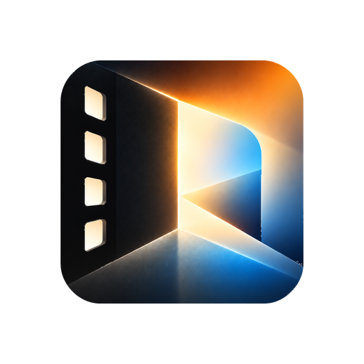
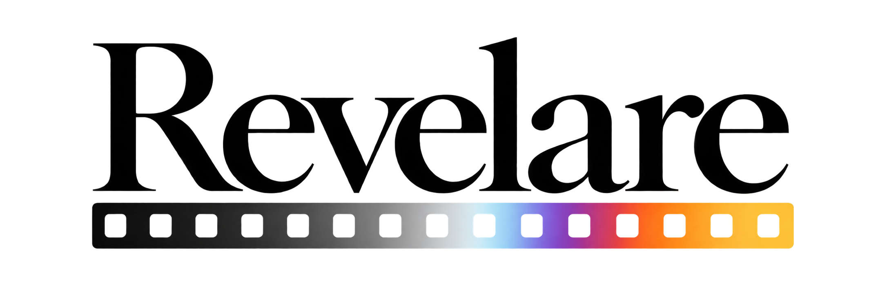
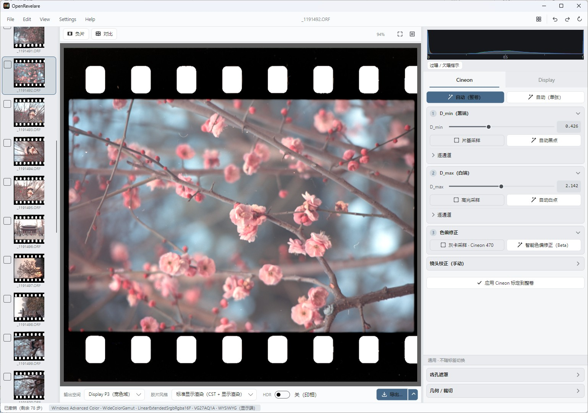
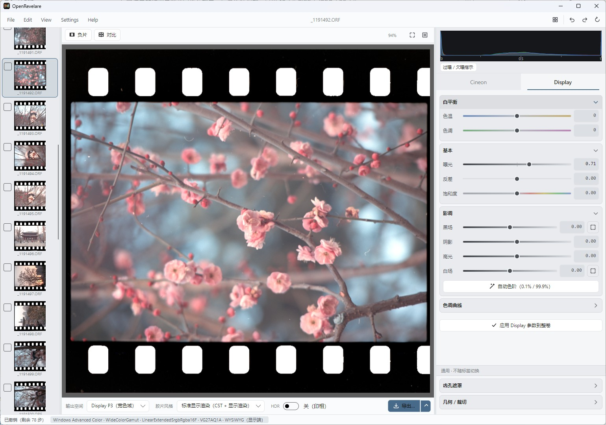
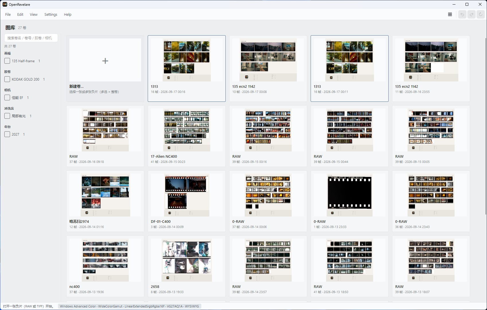
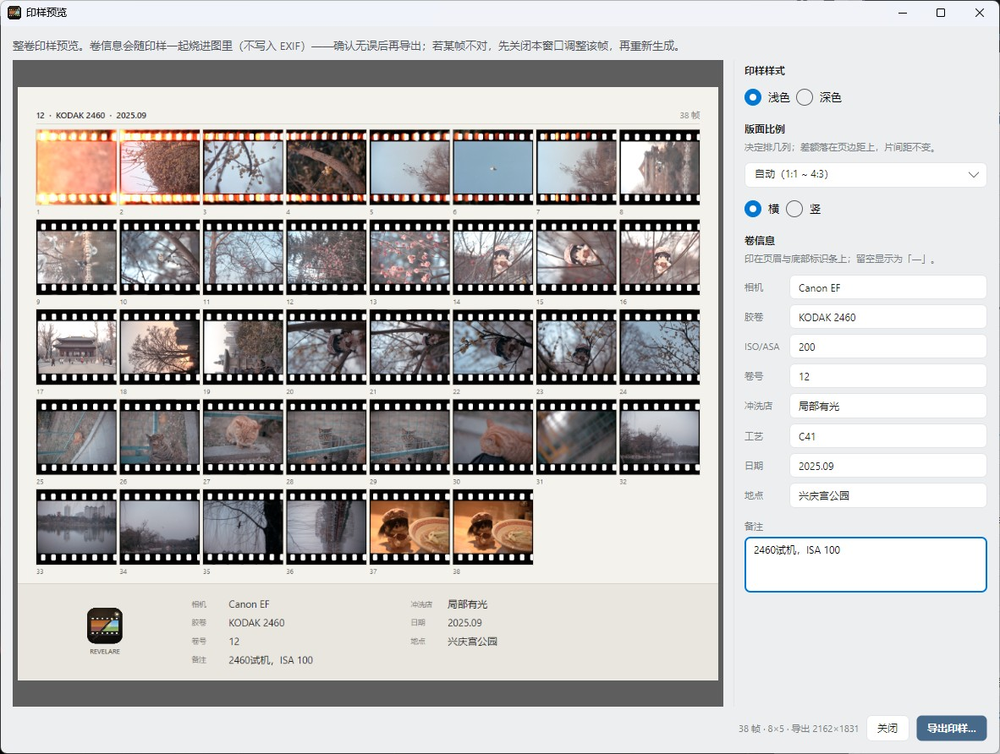
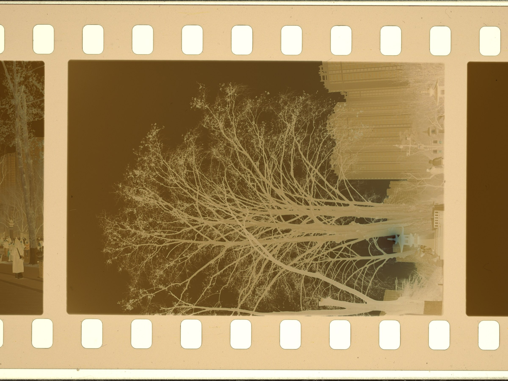
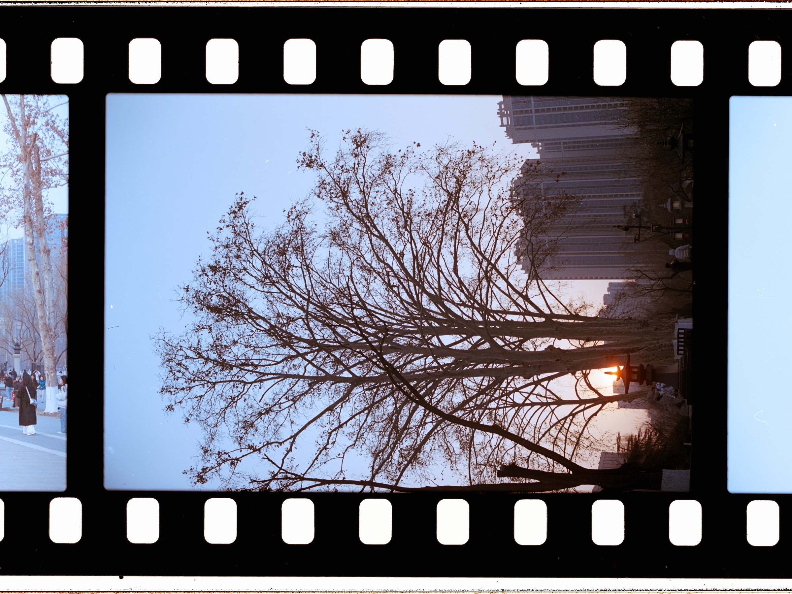
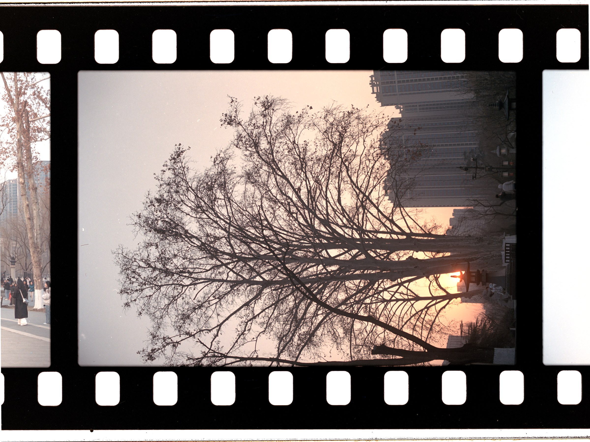

<p align="center">
  
</p>

<h1 align="center">OpenRevelare</h1>

<p align="center">
  
</p>

<p align="center"><b>面向胶片摄影的开源数字暗房</b><br>从翻拍 RAW、扫描 TIFF 到整卷正片，完成校准、修片与导出。</p>

<p align="center">
  <a href="https://github.com/Toshihiko-Lin/Open-Revelare/releases/latest"></a>
  <a href="https://github.com/Toshihiko-Lin/Open-Revelare/releases/latest"></a>
  <a href="https://github.com/Toshihiko-Lin/Open-Revelare/releases/latest"></a>
</p>

<p align="center">
  <a href="https://github.com/Toshihiko-Lin/Open-Revelare/releases/latest"></a>
  <a href="https://github.com/Toshihiko-Lin/Open-Revelare/actions/workflows/ci.yml"></a>
  <a href="LICENSE"></a>
</p>

<p align="center"><a href="README.md">English</a> · <a href="#项目概览">中文</a></p>

<p align="center">
  <a href="#安装">下载</a> · <a href="#处理流程">第一卷</a> · <a href="#项目概览">概览</a> ·
  <a href="#界面与示例">界面</a> · <a href="#功能">功能</a> ·
  <a href="#文档导航">文档</a> · <a href="#从源码构建">构建</a> · <a href="#许可证与第三方组件">许可</a>
</p>

---

## 项目概览

OpenRevelare 是为相机翻拍和扫描胶片设计的独立桌面软件。导入同一卷底片，统一校准片基，再逐帧调整与批量导出；无需订阅，也无需依赖其他修图软件。

彩色负片包含橙色片基与染料层，翻拍或扫描的原始文件通常存在色偏。OpenRevelare 将输入还原为线性光，在 Cineon 对数密度域中完成片基扣除、白平衡与反转，再输出正片。

- **可解释**：片基、最大密度、通道平衡等参数均有明确含义。
- **可复现**：工程参数保存在图像旁的 `.ncproj` 文件中，源文件不被修改。
- **本地优先**：无需账号，图像处理可离线完成；更新检查和可选模型下载使用网络。反转管线由共享 CPU Core 完成；受支持的 Windows/macOS 设备可使用 GPU 加速部分缩放、锐化与 LUT 操作。
- **跨平台**：C# / .NET 8 + Avalonia，支持 Windows、Linux 和 macOS。

适用于相机翻拍或扫描的整卷底片处理、参数归档和跨设备重算。支持 HDR 编辑与导出；Linux 屏幕预览目前明确使用 SDR 回退。不提供逐卷色卡标定；文物翻拍、商业存档和科研用途可使用 [DiVERE](https://github.com/flipswitchingmonkey/DiVERE)。

## 安装

发行包位于 [Releases](https://github.com/Toshihiko-Lin/Open-Revelare/releases/latest)，已包含 .NET 运行时。

| 平台 | 包 | 状态与要求 |
|---|---|---|
| Windows 10/11 x64 | `setup.exe` | 正式版；无需额外依赖 |
| Linux x86_64 | `.AppImage` | 公测；glibc ≥ 2.35 |
| macOS Apple Silicon | `-arm64.dmg` | 公测；macOS 12+，尚无真机验证 |
| macOS Intel | `-x86_64.dmg` | 公测；macOS 12+，尚无真机验证 |

<details>
<summary>平台提示</summary>

- **Windows**：若出现 SmartScreen 提示，选择「更多信息 → 仍要运行」。
- **macOS**：首次启动若提示无法验证开发者，可在「系统设置 → 隐私与安全性 → 仍要打开」确认，或执行：

  ```bash
  xattr -dr com.apple.quarantine /Applications/OpenRevelare.app
  ```

- **Linux**：

  ```bash
  chmod +x OpenRevelare-*.AppImage && ./OpenRevelare-*.AppImage
  ```

  若无法直接启动，可添加 `--appimage-extract-and-run`。Linux 当前使用 SDR 预览；HDR 编辑与导出仍可用。

</details>

## 核心模型

| 阶段 | 作用域 | 内容 |
|---|---|---|
| **FilmBase** | 整卷 | 片基透射率、最大密度、通道平衡和反转参数；物理还原结果 |
| **SceneBase** | 单帧 | 色温、曝光、对比度、饱和度和曲线；创作调整 |

两阶段分离后，物理参数可在整卷范围内复用，单帧调整不会改变物理还原结果。

### 三项原则

1. **色罩是物理量**：通过片基采样获得，不以视觉猜测替代测量。
2. **密度域是计算域**：色罩表现为近似常量偏移，白平衡和反转可按线性关系计算。
3. **还原与创作分离**：FilmBase 负责一致性，SceneBase 负责表达。

## 处理流程

首次使用可先阅读 [第一卷：从导入到重新打开](src/OpenRevelare.Gui/Assets/docs/FIRST-ROLL.md)，应用内「帮助 → 操作指引 / 技术原理 → 第一卷」也可离线查看。

1. **导入**：导入 RAW、扫描 TIFF 或其他支持的图像，并填写胶卷、相机和冲洗信息。
2. **整卷校准**：自动估计片基、白平衡、暗端和 `d_max`，必要时手动修正。
3. **整卷同步**：将 FilmBase 参数应用于整卷或选定帧。
4. **帧编辑**：在 SceneBase 中逐帧调整色温、曝光、对比度、饱和度和曲线。
5. **导出**：输出 TIFF、JPEG、HEIC、线性 DNG 或场景线性 ACEScg TIFF。初次使用可先导出 sRGB JPEG 用于分享，或 16-bit TIFF 用于继续修图。

修改会自动写入磁盘；源目录可写时 `.ncproj` 与源图像位于同一目录，否则使用下方所列的用户级 `rolls` 回退目录。

## 界面与示例

### Cineon 校准

<p align="center"></p>
<p align="center"><sub>整卷缩略图、当前帧和共享物理参数集中在 Cineon 页面。</sub></p>

### Display 调整

<p align="center"></p>
<p align="center"><sub>Display 页面用于单帧创作调整，不改变 FilmBase 参数。</sub></p>

<table>
  <tr>
    <td width="50%"></td>
    <td width="50%"></td>
  </tr>
  <tr>
    <td align="center"><sub>按胶卷管理、筛选和恢复工程</sub></td>
    <td align="center"><sub>包含齿孔排版和卷信息的整版印样</sub></td>
  </tr>
</table>

### 反转结果

<table>
  <tr>
    <td width="33%"></td>
    <td width="33%"></td>
    <td width="33%"></td>
  </tr>
  <tr>
    <td align="center"><sub>翻拍原始输入</sub></td>
    <td align="center"><sub>NLP 自动反转结果</sub></td>
    <td align="center"><sub>OpenRevelare 反转结果</sub></td>
  </tr>
</table>

## 功能

| 类别 | 能力 |
|---|---|
| 反转 | Cineon 密度域反转、自动标定、窄带光源解耦（Path A）、黑白负片模式 |
| 色彩 | ACEScg 工作空间；sRGB、Display P3、Adobe RGB 输出；精确 ICC 管理；Stage 2 调整 |
| 预处理 | LCC 平场、Lensfun 离线镜头匹配、畸变与暗角校正、齿孔遮罩和几何裁切，均在线性光域完成 |
| 工作流 | 按卷管理、整卷同步、虚拟副本、画幅预设、80 步撤销重做、直方图与波形图 |
| 输出 | 16-bit TIFF、JPEG、10-bit HEIC、线性 DNG、32-bit 浮点场景线性 ACEScg TIFF、HDR 增益图 JPEG；文件名模板、缩放和锐化选项 |
| 风格 / HDR | Cineon 输入 `.cube` 印片风格、SDR/HDR 整卷渲染、以档数表示的 HDR 上限、HDR 印样；直接 PQ 或 Adaptive HDR HEIC（需查看器支持） |
| 报告 | 本帧技术报告，记录输入域、片基来源和反转参数 |

支持的输入包括 DNG、NEF、CR2/CR3、ARW、RAF、RW2、ORF、PEF、IIQ、哈苏/Flextight `.fff` 和 TIFF。JPEG/PNG 是导出或界面缓存格式，不是负片导入格式。文件选择器同时接受 RAW 扩展名的大写和小写形式。

## 工作原理

透射率 `T` 转换为对数密度：

$$D = -\log_{10}(T)$$

片基归一化、密度域白平衡和反转分别为：

$$T_{norm} = T / T_{base}$$

$$D_{corr}[c] = D[c] \times w_{high}[c] + w_{offset}[c]$$

$$T_{pos} = 10^{\left(\frac{R_{out}}{D_{max}[c]}D[c]-R_{out}\right)}$$

单帧处理顺序为：线性化 → 线性域光学校正 →（可选）光源解耦 → 片基扣除 → 密度域白平衡 → 反转 → 输出。应用内「帮助 → 操作指引 / 技术原理」提供完整说明。

## 数据位置

| 内容 | Windows | Linux / macOS |
|---|---|---|
| 设置与卷索引 | `%APPDATA%\OpenRevelare` | `$XDG_CONFIG_HOME/OpenRevelare/`（默认 `~/.config`） |
| 印样缓存 | `%LOCALAPPDATA%\OpenRevelare\sheets` | `$XDG_CACHE_HOME/OpenRevelare/sheets/`（默认 `~/.cache`） |
| DNG 解码缓存 | 源文件旁的 `.revelare-cache/` | 同左 |
| 印片 LUT 放置目录 | `%LOCALAPPDATA%\OpenRevelare\luts` | `$XDG_DATA_HOME/OpenRevelare/luts/`（默认 `~/.local/share`） |
| 工程文件 | 源目录可写时为其中的 `.ncproj`；否则 `%APPDATA%\OpenRevelare\rolls` | 源目录可写时为其中的 `.ncproj`；否则 `$XDG_CONFIG_HOME/OpenRevelare/rolls/` |

缓存位置与上限可在偏好设置中调整；卸载不会删除上述数据。

## 文档导航

- [第一卷](src/OpenRevelare.Gui/Assets/docs/FIRST-ROLL.md)：从导入、校准、修片到导出与重新打开工程。
- [操作指南](src/OpenRevelare.Gui/Assets/docs/GUIDE.md)：界面控件与日常工作流。
- [技术原理](src/OpenRevelare.Gui/Assets/docs/THEORY.md)：色彩与反转模型。
- [更新日志](CHANGELOG.md)：各版本功能与修复记录。
- [参与贡献](CONTRIBUTING.md) · [安全政策](SECURITY.md) · [第三方声明](THIRD_PARTY_NOTICES.txt)。

## 常见问题

**可以导入 JPEG 或 PNG 底片吗？** 不可以。请使用支持的 RAW 或 TIFF；建议优先使用 16-bit TIFF，减少暗部色带。

**修片会改动原片吗？** 不会。调整保存在 `.ncproj` 工程中。完整备份时请同时保留原片、工程、LUT 与校正参考文件；导出的 TIFF 不能代替完整归档。

**为什么 HDR 在其他软件中看起来不同？** HDR 显示取决于操作系统、屏幕与查看器。Linux 使用 SDR 预览回退。整卷导出前，建议先在目标查看器中检查一张样片。

**必须安装智能色偏修正模型吗？** 不需要。Deep-WB 是可选功能，接受许可后才单独下载；其 CC BY-NC-SA 4.0 非商业许可与软件的 GPL 许可不同，使用前请阅读[模型许可说明](models/README.md)。

## 从源码构建

需要 .NET 8 SDK、Python 3.12+、CMake 3.21+ 和 C/C++ 工具链（Windows：Visual Studio 2022 C++；macOS：Xcode 命令行工具；Linux：GCC/Clang）。x64 平台构建 HEIC 还需要 PATH 中可用的 NASM 2.13+。首次构建原生依赖需要联网下载经过校验的源码。

先获取源码：

```bash
git clone https://github.com/Toshihiko-Lin/Open-Revelare.git
cd Open-Revelare
```

在 **Windows（PowerShell）** 构建原生依赖：

```powershell
./packaging/lcms/build-windows.ps1
./packaging/libraw/build-windows.ps1
python packaging/compute/build.py
python packaging/heif/build.py
./packaging/windows/build-win32-presenter.ps1
```

在 **Linux / macOS**：

```bash
bash packaging/lcms/build-unix.sh
bash packaging/libraw/build-unix.sh
python3 packaging/compute/build.py
python3 packaging/heif/build.py
```

然后编译、测试并启动：

```bash
dotnet build -c Release -warnaserror
dotnet test -c Release --no-build
dotnet run --project src/OpenRevelare.Gui -c Release
```

[LibRaw](packaging/libraw/README.md) · [Little CMS](packaging/lcms/README.md) · [HEIC](packaging/heif/README.md) · [GPU compute](packaging/compute/README.md). 平台打包与发布检查见 [RELEASE.md](RELEASE.md)。

命令行前端：

```bash
dotnet run --project src/OpenRevelare.Cli -- -i neg.tiff -o pos.tiff --input-linear --color-space sRGB
```

`--input-linear` 与 `--input-srgb` 互斥。为兼容旧版对拍脚本，CLI 仍接受 `--d-max`、`--grade`、`--pivot` 和 `--scan-exposure-ev`，但这些参数现在是空操作；当前反相由两端密度标定与输出范围控制。

开发前请阅读 [CONTRIBUTING.md](CONTRIBUTING.md)。标定实验见 [`docs/calibration/`](docs/calibration/)，色彩管理记录见 [`docs/color-management-architecture.md`](docs/color-management-architecture.md)。

## 许可证与第三方组件

代码采用 **GPL-3.0-only**，见 [LICENSE](LICENSE)。

Deep-WB 为可选下载：首次点击「智能色偏修正」时确认许可后安装，也可运行 `OpenRevelare.Cli --install-deep-wb`。默认安装包不含模型权重。 GitHub 下载失败时自动尝试 [Gitee 国内镜像](https://gitee.com/Toshihiko-Lin/openrevelare-models/releases/download/deep-wb-v1/net_awb.onnx)，也可手动下载后离线安装。ONNX 推理运行库仍随包提供。

`models/net_awb.onnx` 为 Deep White-Balance Editing 模型，按 **CC BY-NC-SA 4.0** 单独授权，不属于本项目 GPL 范围。详情见 [models/README.md](models/README.md) 与 [THIRD_PARTY_NOTICES.txt](THIRD_PARTY_NOTICES.txt)。

主要参考：[LightSourceDecouple](https://github.com/karasuyasabou/LightSourceDecouple)、[DiVERE](https://github.com/flipswitchingmonkey/DiVERE) 和 darktable `negadoctor`。

## 项目来源与致谢

项目最初是作者用于个人胶片翻拍的工具，经过用户反馈和底层重构后，于 2026 年 8 月以跨平台开源项目发布。感谢以下用户对早期开发与完善提供的支持：

- 豆腐
- Caramello_焦糖玛奇朵
- REPEATER000
- jamais
- hhd

## 项目支持

项目由个人持续维护，核心功能以 GPL-3.0-only 开源。若项目对工作流程有帮助，可通过以下方式提供支持：

<p align="center">
  
  
</p>

## 限制与反馈

- 不提供逐卷色卡标定。
- 8-bit TIFF 暗部可能出现色带，建议使用 16-bit 输入。
- Linux 使用明确标注的 SDR 屏幕预览回退，但 HDR 编辑和导出仍可用。
- macOS 原生呈现仍待真机验证；TIFF/CPU 渲染不受影响。

请通过 [issue](https://github.com/Toshihiko-Lin/Open-Revelare/issues) 报告问题，并附系统版本、相机或扫描仪型号、输入格式与错误信息；不要上传含隐私内容的原片。

<p align="center"><sub>OpenRevelare 以 GPL-3.0-only 开源发布。</sub></p>
