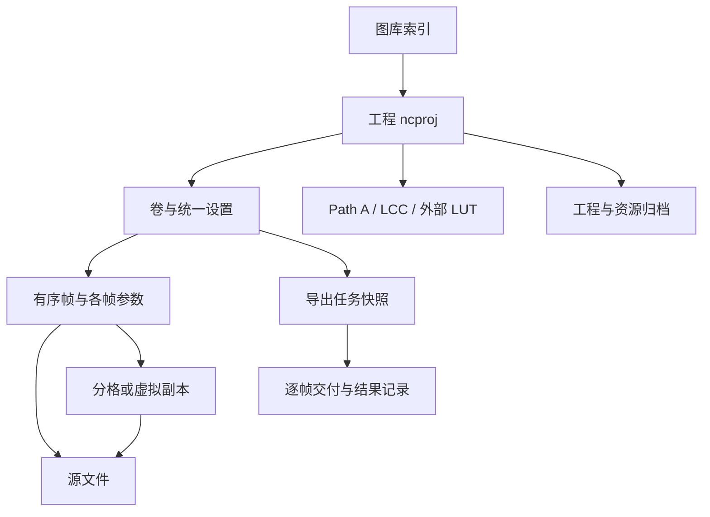

# 产品对象与功能框架

## 1. 产品任务与边界

OpenRevelare 的核心任务是将一卷数字化负片转为可交付正片，并保留可复算的工程。工作链是：原片准入 → 输入解释／参考校正 → 底片标定 → 成片调整 → 构图修复 → 输出 → 重开与归档。

这不是单纯的照片浏览器：图库背后有工程；也不是把所有调色都放进一个滤镜：底片端点、成片曝光、渲染空间和文件编码有不同含义。

GUI 是本次全量拆解的边界。CLI、原生呈现、Core、GPU 与编解码器仅在影响可见行为时进入框架，不逐个盘点非 GUI 命令行参数或内部算法函数。

## 2. 数据对象：先明确用户到底在操作什么

### O01 原片 Source

文件路径对应 RAW 或 TIFF；源图像不因 GUI 调参被覆盖。文件会有版本与指纹检查。RAW 和 TIFF 的输入解释不同，不能当作仅扩展名不同的照片。

### O02 帧 Frame

卷内的编辑单元，有独立参数、裁切、方向、修复点与缩略图。一个文件可对应一帧、扫描分割得到的多帧，或多个虚拟副本；不能把“帧数”自动解释为“源文件数”。

### O03 当前帧 CurrentFrame

预览、滑条、采样、普通复制与本帧粘贴的对象。单击缩略图切换；右击缩略图也会先切换当前帧。它与批量勾选是两套状态。

### O04 勾选集合 IsSelected

缩略图勾选框与 Ctrl/Command、Shift 手势维护的批量目标。可包含当前帧，但部分同步会主动排除当前帧。成功的部分批量操作会清空勾选；普通切帧不等同清除勾选。

### O05 卷 Roll

有序帧集合、卷信息、统一的输入路径／参考及部分渲染选择。FilmBase 是可整卷复用的参数族，但大量值实际存于各帧：不能据“整卷校准”标题认定滑条是共享引用。

### O06 工程 Project

`.ncproj` 保存编辑与资源声明，不包含原始照片本体。源目录可写时通常放在原片旁，否则使用用户级回退目录。工程副本、完整归档和成片导出是三种不同交付物。

### O07 图库 Catalog

卷索引与封面，指向工程。移出图库、删除工程、移除卷内帧是三个不同动作；重建图库不等于恢复已删除的工程参数。

### O08 外部参考 Dependency

Path A 校正、LCC、外部 LUT 等。声明、启用、文件存在、内容有效是不同状态。禁用不一定等于不再依赖或不需要归档。

### O09 导出任务 ExportJob

开始时冻结参数与目标路径，逐帧记录完成／失败／跳过／未执行。重试读取当前原片，但沿用原任务参数。它不是把当前屏幕状态再执行一遍。

### O10 应用偏好 Settings

跨卷默认值、解码／缓存／GPU、语言和主题。导出选项多数可记忆，但本次场景线性选择、卷渲染空间、HDR 上限和逐帧拍摄信息不能简单当成永久导出预设。

来源：`Models/RollFrame.cs`、`Models/ExportOptions.cs`、`Services/Catalog.cs`、`Services/BatchExportStore.cs`、`Core/Project.cs`、`MainViewModel.Project.cs`。

## 3. 处理职责与 GUI 分层

1. **输入层**：解码 RAW、解释 TIFF、应用光源／平场与镜头校正。输入声明错误会影响后续所有判断。
2. **底片标定层**：黑端 D_min、白端 D_max、灰卡／智能色偏修正、黑白片型。自动高光是场景代理，不是物理实测 D-max。
3. **成片层**：色温、色调、曝光、反差、饱和度、黑白场、阴影高光、曲线。
4. **构图修复层**：旋转、翻转、拉直、裁切、齿孔填白、手工除尘。界面归在一组不意味着算法在同一阶段；除尘位于反相前。
5. **渲染层**：卷的渲染空间、印片 LUT、SDR/HDR 与上限，决定预览及输出语义。
6. **呈现层**：缩放、负片查看、跳过成片调整的对比、遮罩叠加、直方图、波形图、裁切警示。查看状态通常不等于参数修改。
7. **交付层**：文件容器、编码、尺寸、锐化、EXIF、命名、冲突策略与任务结果。

## 4. 全部功能域

### F01 全局导航与窗口

- 顶级 File / Edit / View / Settings / Help；顶级名称固定英文，内容按语言变化。
- 图库／修片切换；修片需要有效图像。撤销、重做、重置常驻。
- Windows/Linux 窗口菜单与 macOS 原生菜单复用处理器；macOS 偏好和关于位于应用菜单。
- 主窗口默认 1280×840，最小 800×520；宽度低于 1100 时，右侧检查器移动到预览下方，工作区允许竖向滚动。
- 可调整胶片栏／预览／检查器分隔；当前实现不是所有尺寸都保持三栏。

### F02 图库检索与卷管理

- 空图库的新建入口；有内容时的卷墙、新建卡片、缓存封面、缺失工程状态。
- 搜索卷名、卷号、胶卷、相机；分面为画幅、胶卷、相机、冲洗店、年份，空分面不显示。
- 添加时间、最近修改、最近打开、卷名、卷号、冲洗日期排序，支持方向切换；缺值置后。
- 单击选卡、双击打开、右键打开；卷重命名、卷信息编辑。
- 复制已生成的封面印样；定位工程文件；重新指定工程位置。
- 从图库移除与删除工程分别存在，均有确认；删除工程会丢失编辑，但不删原片。
- 文件菜单还有最近卷、打开 `.ncproj`、递归扫描文件夹登记工程。

来源：`LibraryView.axaml(.cs)`、`LibraryViewModel.cs`、`Services/RollOrder.cs`。

### F03 新建与导入

- 添加文件、添加文件夹、移除列表选中项、清空、计数、就绪说明、取消、导入。
- 原片为 RAW／TIFF；同卷不混输入族。JPEG/PNG 不是本产品负片导入路径。
- 高级导入默认折叠：扫描多格分割、宽谱 Path B／窄谱 Path A、Path A 参考目录及检测反馈、LCC 启用与路径。
- 自动整卷分析默认选择可继承偏好；取消自动分析意味着不做自动测量，不能期待已自动去色罩。
- 选项不满足时禁用导入并显示原因；不能用隐藏高级项来掩盖未满足依赖。
- TIFF 有效 ICC 优先；缺少可信声明才提示当前假设，并允许“改为线性／确认 sRGB”。这是导入后的纠正入口。

注意：`ImportConfig` 中仍有“导入时必须选择 Linear/sRGB”和“导入填写卷注释”等旧注释，当前导入 XAML 不对应这些描述。不要据数据类注释设计不存在的输入步骤。

### F04 扫描底片分割

- 文件列表与每条分割摘要；识别结果预览。
- 拖分隔线、拖外框四边；双击线删除、双击空白新增。
- 格数减／加重新等分；这条不分割、全部不分割、取消导入、按此导入。
- 全部导入共享裁切余量，0–0.5，初始声明 0.15。
- 预览旋转、放大缩小、滚轮缩放、拖动平移、复位；这些旋转只影响分割查看，不旋转导入后的帧。

### F05 胶片栏与结构操作

- 缩略图、文件名、待解码反馈、当前帧高亮、批量勾选。
- 全选、清空勾选；单点／范围／累加范围选择。
- 添加图像；虚拟副本复制参数与裁切，共用原片；副本也能再复制。
- 移除帧：移除真实帧还会移除同源虚拟副本；至少保留一帧。
- 拖动排序与按文件名排序；添加、排序、副本、移除进入结构撤销事务。
- 右键提供标定／成片参数同步、构图同步、同步项配置。

### F06 预览与测量

- 正片／负片切换；对比显示跳过成片调整的画面，不能理解为未经任何处理的原片。
- 适合窗口、实际像素 100%、缩放读数、滚轮缩放与放大后平移。
- 背景白／浅灰／中灰／18% 灰／深灰／黑；浅深主题与背景是不同选择。
- 直方图与波形图可独立显示；过曝／欠曝指示及阈值。
- 齿孔遮罩叠加、修复范围叠加、修复笔刷环、框选及拉直线、裁切草稿。
- 当前输入解释、分析中临时预览、旧色彩管线迁移提示；关闭提示不代表完成其任务。
- 原生预览区域与 Avalonia 叠层有平台约束，提示条位置需要结合实际原生呈现状态安排。

### F07 底片标定

- 输入与校正详情：输入域／参考摘要、本帧校准依据；畸变、暗角、暗角范围、载入 LCC 与启用。
- 黑白负片为卷级判断；隐藏无意义色彩控件但保留参数，切回彩色可恢复。
- 自动整卷／自动单张；自动不改变裁切，但会重估标定。
- D_min 总量与 RGB 通道，片基采样、自动黑点、证据／置信度。
- D_max 总量与 RGB 通道，高光采样、自动白点、证据／风险。
- 灰卡采样 Cineon 470、智能色偏修正 Beta、灰卡读数。它们与高光采样会写同一组白端，后操作可能覆盖先操作。
- 应用标定到整卷；按同步项控制端点／色度／镜头与平场，不包括裁切和齿孔。

数值声明：D_min −0.5–2，默认 0；D_max 0.3–4，默认 2；总量步长 0.005，通道步长 0.001。畸变 −0.5–0.5，暗角 −1–2，暗角范围 1–6。真实生效约束仍需结合 VM 验证。

### F08 成片调整

- 色温、色调及正片中性区域吸管；吸管仅改成片白平衡，不改底片端点。
- 曝光 −3–3 EV，反差／饱和度 −1–1。
- 黑场／阴影／高光／白场 −1–1；黑场与白场框选、自动色阶。
- M／R／G／B 曲线、背景直方图、主曲线保留色相。
- 曲线左击加点／拖点；右击删内部点，端点右击复位；重置只针对当前曲线通道，面板外重置另有范围。
- 应用成片参数到整卷；可通过同步项排除曝光等分组。
- SliderRow 支持滑条、数字微调、双击标签恢复默认；拖动与松手有不同预览调度阶段。

色温／色调范围 −250–250 是当前产品相对量，不能在新界面直接加 Kelvin 单位。

### F09 齿孔、修复与构图

- 齿孔启用、显示遮罩、亮度阈值 0.05–1，默认 0.9；独立同步。
- 启用除尘、显示修复范围、笔刷半径 0.001–0.03，默认 0.006；修复笔、擦除笔、清除全部。
- 手工源图坐标修复点随工程保存；自动单帧除尘已下线，不列为现有功能。
- 画幅预设、自由裁切、清除裁切、应用／取消草稿。
- 顺逆时针 90°、水平／垂直翻转、拉直滑条 −15°–15°、水平／垂直参考线拉直。
- 几何同步不含裁切；裁切与齿孔各自单独同步；除尘不在色彩同步项中。

### F10 整卷渲染

- sRGB／Display P3／Adobe RGB 整卷渲染空间；改变它可能改变已编辑画面，并非单纯文件标签。
- 标准显示渲染、内置／外部 `.cube` 印片 LUT；LUT 输出解释菜单包含 Rec.709 Gamma 2.4、DCI-P3 Gamma 2.6、sRGB、HDR PQ 条件项。
- HDR 开关与上限 0.5–4 档；可用性由当前渲染路线决定。
- Linux 使用 SDR 屏幕回退，不应把屏幕回退等同禁用 HDR 编辑与文件输出。

### F11 文件输出

- 当前帧、整卷、印样三种入口。当前整卷导出遍历全部 `Frames`，不读取批量勾选。
- 格式：JPEG、HEIC、TIFF、线性 DNG。格式卡说明随 SDR/HDR 改变。
- TIFF 无损 LZW／Deflate／不压缩；场景线性 ACEScg 为本次输出选项，跳过成片调整和显示渲染。
- JPEG／HEIC 品质、文件大小上限；先降低品质，仍超限再缩尺寸。
- HDR JPEG 为 SDR 基图＋增益图；HDR HEIC 可选单层 PQ 或 Adaptive HDR；HDR TIFF 是 32-bit float 母版。DNG 有独立标签约定。
- 增益图基底 sRGB／P3；ICC 可省略与必须嵌入按输出路线确定，不是永远自由的复选框。
- 长边 256–20000px、允许放大、输出锐化；锐化不适用于场景线性、DNG、HDR 路线。
- 原文件名／卷名序号／卷号序号／冲洗日期卷名序号／卷名胶卷序号／卷名原文件名／自定义，显示展开实例。
- 整卷冲突策略：另存新名／覆盖／跳过；同批内部重名仍另存。
- 结论条显示最终文件性质；选项确认后再选保存位置，之后才执行写入。

### F12 元数据与印样

- 卷信息用于图库与印样：画幅、相机、胶卷、卷号、冲洗店、日期、地点、备注等；印样面板另有 ISO/EI、工艺等字段，不能假定不同入口字段完全相同。
- 导出信息抽屉：胶片机身／镜头库、品牌型号序列号、逐帧 ISO／光圈／快门／焦距／拍摄时间、作者版权、是否写入；机身与镜头可同步整卷。
- 源 EXIF／数字化来源与胶片拍摄信息分开，不能把翻拍相机曝光当成胶片曝光。
- 印样浅／深样式、自动／1:1／4:3／3:2、横竖版、约 6／12／24MP、HDR 印样、卷信息预览。
- 印样窗口预览为 SDR，HDR 输出另有文件含义。图库“导出印样”只是复制已缓存封面，修片区“导出印样”会重新构建。

### F13 保存、依赖、归档与恢复

- 独立待保存／保存中／已保存／失败状态、路径与时间、失败重试。
- 关闭前等待保存；失败允许重试、另存恢复副本、继续编辑或明确放弃。
- 工程依赖清单及 JSON 导出；原片／参考恢复、指纹匹配、旧工程额外确认。
- 归档复制原片、声明的参考和 LUT，生成 `project.ncproj`、`checksums.json`；失败／取消不发布半成品目录。
- 批量导出逐帧结果、输出目录、失败及未执行重试、跨重启恢复及恢复被阻止的原因。
- 输入文件修改后拒绝旧结果／重解码；参考变化需要明确重载，不能静默换颜色依据。

### F14 偏好与支持

- RAW 后端自动／LibRaw／Adobe DNG Converter，FBDD 关闭／轻度／完全，自动并发／固定 1–8。
- GPU 自动／关闭；导入后自动分析默认值。
- 磁盘缓存启用、跨会话保留、目录选择／恢复默认、容量；卷封面印样另有目录与容量。
- 深浅主题、跟随系统／中文／English；主题与语言即时预览，取消恢复已保存状态。
- 首次启动离线指引（本机标记控制）、命令行传入工程／文件的启动入口；检查更新另有后台检查与手动入口，下载打开外部链接，不等于应用内自动替换版本。
- 操作指引／技术原理／第一卷、快捷键、技术报告查看／复制、显示链路诊断复制、LUT 文件夹、检查更新、关于。
- 技术报告回答“本帧怎么处理”，显示诊断回答“这台机器如何显示”；不能合成一个不区分问题来源的报错出口。

## 5. 覆盖与待补证

以上按功能去重；所有 XAML 入口逐条见自动索引。动态偏好、卷信息、报告、保存失败、依赖清单与 macOS 原生菜单通过 C# 上下文补充。

未据源码推断用户真实使用频率、算法可靠率或 HDR 设备表现。后续需要真实材料验证各输入分支，并把“默认路径”“高级路径”“恢复路径”分别计时和观察。
