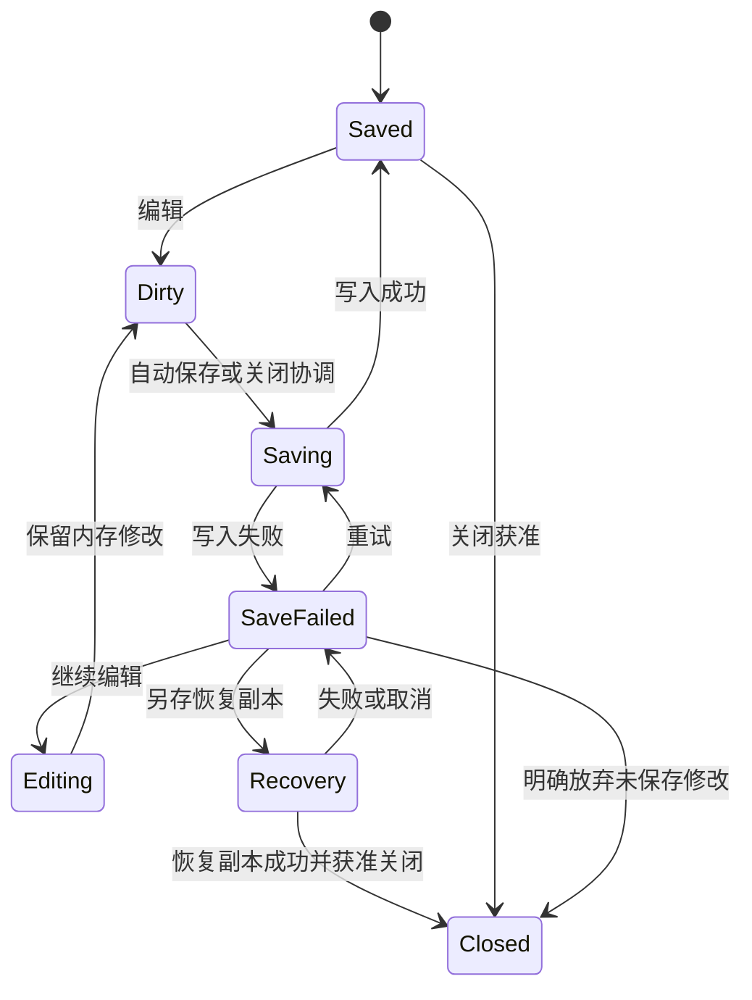

# 操作契约与完整流程

## 1. 所有操作都应具有的字段

后续设计或实现一个操作，至少记录：用户意图、入口、前置条件、数据来源、目标范围、写入字段、预览变化、保存影响、撤销边界、进行中反馈、取消语义、失败恢复。原生菜单、右键、工具栏和快捷键是同一操作的不同入口。

控件细节由 [逐项索引](control-inventory.md)补充，不能仅从 `Click` 名字判断范围。下文给出最容易混淆的操作及已核对的方法。

## 2. 选择与批量范围：当前真实规则

### A01 单击／右击缩略图

来源：所点缩略图。结果：切换 `CurrentFrame`，刷新参数与预览。既有勾选可能继续保留。右键菜单中的“本帧”和“勾选帧”因此可能指向不同对象。

### A02 维护批量勾选

复选框或 Ctrl/Command 点击切换单帧；Shift 选择锚点到点击帧的闭区间；Ctrl/Command+Shift 累加范围。修饰点击同时更新当前帧。全选和清除选择只控制批量勾选。

### A03 滑条／数字输入／单帧采样

来源、目标均为当前帧，即使另有若干帧已勾选。普通参数编辑会调度预览与保存。黑白模式、LCC 启用、渲染空间和 HDR 等明确卷级设置另有规则，不能套用“所有检查器控件都只改单帧”。

### A04 复制标定／复制成片参数

从当前实时参数生成内部剪贴板快照；不会立即修改目标。不是复制图像，也不是系统剪贴板文本。分别维护两种剪贴板。

### A05 粘贴到本帧

来源为内部剪贴板，目标为当前帧；按 `SyncOptions` 过滤。保留未选分组的实时调整。没有对应剪贴板时提示尚未复制。

### A06 粘贴到勾选帧

来源为内部剪贴板，目标为勾选集合**排除当前帧**。没有勾选，或唯一勾选的是当前帧时，没有可应用目标；不退回整卷或本帧。成功后清空勾选。

因此“勾选 5 帧”不一定等于“应用 5 帧”。若其中包含当前帧，实际目标为 4 帧。GUI 应显示计算后的目标数。

### A07 应用标定／成片参数到整卷

来源为**当前帧实时参数**，目标为其余全部帧，忽略勾选。它不是把之前复制的剪贴板广播出去。按同步分组过滤，完成后刷新缩略图；当前 `Broadcast` 不负责清空既有勾选。

### A08 同步旋转翻转拉直／裁切／齿孔

来源为当前帧。有勾选时使用勾选目标，无勾选时使用其余整卷；都排除当前帧。成功且原先有勾选时清空勾选。几何不含裁切；裁切需要处理目标方向和扫描分格坐标换算；齿孔不混入色彩同步。

### A09 创建虚拟副本／从卷移除

有勾选则作用于勾选，否则作用于当前帧，不是退回整卷。副本共享原片，复制参数。移除真实帧会连带同源虚拟副本；不能移除卷内最后一帧。结构操作可撤销，不删除原片。这里的范围又不同于 A08。

### A10 单帧与整卷导出

“导出当前帧”处理当前帧；“导出整卷”遍历全部帧，包含虚拟副本与扫描分格，**忽略勾选**。现有代码没有因为勾选而自动变成“导出所选”。后续若增加这个能力，要单列操作和任务目标，不能只换文字。

以上证据：`MainWindow.axaml.cs:1565`、`MainViewModel.Sync.cs:56` 起、`MainViewModel.Roll.cs:1143` 起、`:1687` 起。

## 3. 色彩同步实际字段

所有七个同步组默认打开；只配置色彩，不包括构图、齿孔或除尘。

- **端点组**：TBase、DMin RGB、DMax RGB 一起传递，避免标尺和端点不匹配。
- **色度组**：ChromaChannelScale。
- **镜头与平场组**：畸变、暗角量、暗角范围、平场数据；LCC 启用状态本身是卷级语义，不能据复选框名认定整个依赖声明都在组内复制。
- **白平衡组**：成片 WbGains。
- **曝光组**：ExposureEv。
- **影调组**：黑白场、反差、高光、阴影、饱和度。饱和度目前随影调同步，不是独立组。
- **曲线组**：四通道点、保留色相、端点解释标记；仅复制点而漏掉解释标记会改变曲线意义。

标定同步还携带 `OutputIntent`。成片同步组全部取消时会阻止执行并提示。批量参数准备先验证所有目标，再统一提交；失败不会先应用前几帧。成功作为一个撤销事务。

同步配置窗口为实时绑定，只有“关闭”；它不是有“确定／取消”的临时选项草稿。

## 4. 标定与采样操作

### A11 自动整卷

重新分析全卷并统一写入标定，忽略勾选；耗时取决于解码与材料。导入可先显示临时结果，再刷新最终结果。不能在“已出现画面”时认定已标定完成。

反复执行会覆盖已有端点等标定依据，应明确“重新分析”。自动高光来源是场景代理，人工修改端点后旧置信度不再适用。

### A12 自动单张

重新测当前帧；不改其他帧，也不改裁切。用于例外帧，但不应被误认为自动修复输入声明错误。

### A13 片基／高光／灰卡采样

进入专用模式，自动切换适合定位的负片视图；拖出区域并释放后提交。Esc 退出。片基取未曝光透明片基；高光取负片最浓处；灰卡取已知灰卡。灰卡与高光不是两种互不干扰的附加调整，它们可写同一白端。

### A14 成片白平衡／黑场／白场采样

在正片中选择对应区域。成片中性采样只改色温与色调，不改 D_min/D_max；超出滑条范围需要返回输入或标定诊断，不应无限重复采样。

### A15 智能色偏修正

Beta 的推断入口，作用当前帧；不是实测灰卡。需要区别模型推断、手动测量、自动统计三种来源，不能在 GUI 都显示成“已正确校准”。模型可用性和失败提示需运行态验证。

## 5. 预览工具状态机

### A16 框选与拉直

普通查看 → 激活工具并显示提示／选中态 → 按下拖动 → 释放后测量或拉直 → 结果渲染。切工具、Esc、切帧都要处理旧模式和未提交内容。不同采样模式对正负片显示的切换应有明确反馈。

### A17 裁切草稿

普通查看 → 进入裁切，显示未裁区域及已有框 → 拖边／框选／比例预设 → Enter 或应用提交；Esc 或取消丢弃。未提交草稿与已经保存的裁切不是同一数据。

当前关闭提示条会连同应用／取消按钮隐藏，键盘仍可操作；源码专门重新聚焦叠层保证快捷键工作。此行为可达，但鼠标用户是否理解需要验证。

同步或复制期间不能把为了显示全图而暂时抑制的裁切写回空值；当前代码通过 `LiveParams.ForStorage` 保留真实存储裁切。

### A18 修复笔

选修复／擦除模式 → 悬停显示半径 → 按住连续画 → 松手结束笔划 → 预览。显示遮罩只改变检查视图；擦除笔去掉已标记修复，不是对图像涂抹原色。`[`／`]` 每次调半径 0.001。

### A19 滑条与曲线

开始拖动 → 低延迟交互预览 → 持续更新 → 松手／捕获丢失收束 → 较完整预览。数字输入和双击标签复位还要有同等清晰的撤销结果。不能将拖动中画面暂时低清误报为图像质量下降。

### A20 重置本帧调整

当前 `OnResetClick → ResetAdjustments` 并不跟随打开的标签页。它会重置镜头参数、齿孔、底片端点、成片白平衡／影调／曲线、旋转翻转拉直／裁切，并清除扫描分格 `SplitCell`，以及部分标定诊断。它不是“只恢复当前成片滑条”，也不能泛称“删除所有编辑”：方法并没有显式清除修复点、所有卷级模式或所有外部依赖。

新设计必须按实际字段定义重置范围，尤其是扫描分割帧。拆分重置按钮是建议，尚未实现。

## 6. 保存与关闭状态机

编辑产生新修订 → 待保存 → 保存中 → 成功显示已保存及路径／时间；失败显示持续状态并允许重试。封面重建与工程保存是不同脏状态，不能互相代替。

关闭请求 → 暂停新交互并等待在途任务／保存协调 → 成功再关闭。失败保持窗口和会话资源：

- 重试保存：重新等待并保存。
- 另存恢复副本：选择新位置，成功后才允许关闭；取消选择不等于放弃。
- 继续编辑：返回仍在内存的工作。
- 放弃未保存修改并关闭：明确的丢弃动作。

参考缺失时工程保留原声明，不静默改 Path A/B 或 LCC 选择；无法可靠复算时阻止导出。预览仍可能是最后一次有效图像，不代表资源已经恢复。

## 7. 完整用户流程

### W01 第一次处理普通 RAW 整卷

1. 图库新建卷，添加同一输入族文件；保持 Path B 和自动分析。
2. 确认导入就绪，进入修片；看到解码、临时预览与分析中反馈。
3. 等最终分析完成，检查片基来源与高光代理，不只看照片是否“好看”。
4. 选代表帧，必要时校准；若已统一标定，不重复执行同步。
5. 进入成片调整，逐帧修正曝光／白平衡；构图和修复按需要处理。
6. 导出代表帧，确认最终格式／色彩／尺寸／元数据，再选位置。
7. 用下游软件检查后导出整卷，查看逐帧结果。
8. 确认保存完成；重开工程核对参数及构图，最后按需要完整归档。

失败分支：原片无法解码 → 显示文件和原因，替换支持的原片／先用可读 TIFF；保存失败 → 进入保存恢复；参考或输出路径失败 → 修复原因后重试，保留已完成文件。

### W02 扫描 TIFF：有 ICC／无可信声明／整条分割

1. 添加 TIFF；普通单帧不勾分割，整条扫描件才开启。
2. 分割预检逐条检查外边界、格数和分隔线；异常条可不分割，全部不分割仍继续导入，取消导入才终止。
3. 按此导入后检查 TIFF 输入解释；有效 ICC 自动使用，无可信声明时才出现假设提示。
4. 若切换线性／确认 sRGB，整卷重解码并保存解释；重新检查标定，不能沿用错误输入下的视觉判断。
5. 逐帧精调、导出、重开；额外检查同源分格的裁切、虚拟副本和重置行为。

### W03 Path A 与 LCC

1. 选择对应窄谱路径和 R/G/B 参考目录，等待识别；LCC 另选同输入族参考。
2. 无效参考时导入禁用或报错；修复路径／输入族后继续。
3. 校正改变后重跑分析，检查证据。
4. 归档包含参考；重新打开时缺失则保留声明并阻止降级导出。

### W04 代表帧同步到部分帧

1. 在源帧确认要同步的组，复制标定或成片参数。
2. 勾选目标，计算排除当前帧后的实际数量。
3. 选择“粘贴到勾选帧”，不是 Ctrl+V 本帧粘贴，也不是整卷应用。
4. 失败时所有目标都不应用；成功后勾选清空，抽查目标与非目标。
5. 误同步立即撤销；再做新的精调前先确认恢复。

另一路“应用到整卷”直接读取当前帧，不需要先复制，忽略勾选。两条路线应在设计中明确区分。

### W05 分享图与后期／HDR 交付

1. 先确定工程当前 SDR/HDR 与渲染空间，不把导出格式理解为改变卷观感。
2. 根据用途选 JPEG／HEIC／TIFF／DNG 或场景线性 TIFF。
3. 确认继承的空间、HDR 载体、ICC、是否包含成片调整、尺寸／锐化和命名。
4. 先导一张并在真实目标软件检查，再导整卷。
5. 若需要与当前卷不同的 SDR 分享渲染，当前没有一个可以假定存在的自动转换按钮。后续可以设计派生交付，但必须实现对应管线语义。

### W06 批量中断、部分失败与重试

1. 开始任务前保存并冻结参数／路径；逐帧更新结果。
2. 取消 → 正在取消，等待当前步骤结束；已完成文件保留。
3. 结果区分完成、失败、未执行、跳过，查看原因和输出目录。
4. 重试失败及未执行；工程／LUT／参考或已完成文件等关键依据变化时可能阻止旧任务重试，需要新建任务。
5. 关闭后重开工程仍可查看上次结果；这是已有能力，不是本次待开发功能。

### W07 重定位与可恢复归档

1. 分清缺失的是图库指向的工程、工程引用的原片，还是参考／LUT。
2. 工程移动 → 重新指定工程位置；索引丢失 → 扫描 `.ncproj` 目录；资源缺失 → 恢复工程参考。
3. 核对同名文件指纹；旧工程无指纹时需要额外确认。
4. 查看依赖清单可导出 JSON，但这不会复制任何资源。
5. 完整归档复制资源、写相对引用及校验清单；取消或失败不发布半成品。
6. 将归档放到新路径重开验证。已能打开工程不等于全部依赖有效。

### W08 印样及卷信息

修片区生成整卷缩略图 → 印样预览 → 调版式／卷信息 → 导出或关闭。关闭窗口不一定撤销版式／信息修改；HDR 开关改变文件类型，窗口仍展示 SDR 版。图库的同名导出入口复制缓存封面，可能与当前最新渲染不同。

### W09 删除与恢复

卷内移除：确认实际目标和连带副本 → 移除 → 撤销恢复结构与参数；不删原片。图库移除：确认只移出索引 → 重新打开工程可登记回来。图库删除工程：确认参数文件会被删除且不可撤销；不要对它承诺卷内 Ctrl+Z 的恢复能力。

## 8. 快捷键与鼠标行为

以下按主窗口 `OnKeyDown`，macOS 的 Accel 为 Command，其余平台为 Ctrl；菜单和提示的字面 Ctrl 不应替代平台映射。

- G：图库；D：修片；F：适合窗口；N：负片；K：跳过成片调整的对比；J：过曝／欠曝指示。
- Accel+1：100%；Accel+N：新建；Accel+O：添加图像；Accel+E：导出当前帧。
- Accel+Z：撤销；Accel+Y 或 Accel+Shift+Z：重做。
- Accel+C／V：按当前标签复制／粘贴到本帧，且仅修片、非文字输入时使用。
- Accel+Shift+T：切主题；Accel+,：偏好。
- Esc：取消裁切或退出当前工具；Enter：提交裁切。
- `[`／`]`：仅修复工具激活时调笔刷。
- 裸字母快捷键在 TextBox 输入时避让；数字、下拉、自定义曲线控件的焦点冲突仍需实测。
- Ctrl/Command／Shift／组合点击：批量选择；拖缩略图：排序；右击缩略图：先切当前帧再开菜单。
- 双击滑条标签：复位该数值；曲线右击：删内部点／复位端点。
- Windows/Linux 退出菜单标示 Alt+F4；macOS 的 Command+Q、关闭窗口等由系统菜单机制提供，不能当成本次三平台实测结论。

## 9. 反馈体系

必须区分：短操作结果、持续保存状态、显式长任务进度、后台缩略图状态、参考／输入警告、显示链路状态、工具操作提示。

当前已有部分独立通道，但它们在窄窗、多个警告并存和原生预览时可能竞争空间。设计不能只保留一条“状态栏文本”来承载全部信息；也不能把关闭警告卡片当成用户已经解决警告。
