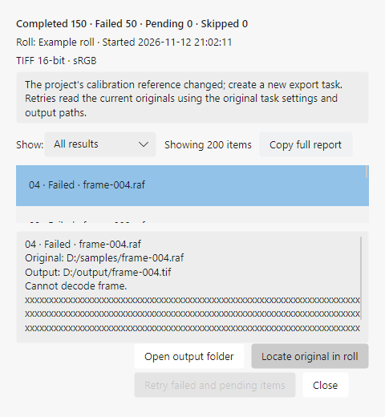
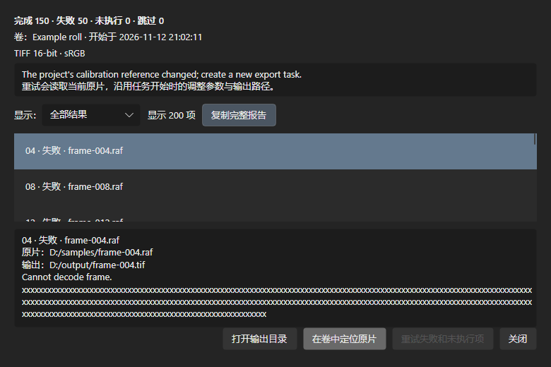

# 结构化批量导出结果

2026-11-12，NegPy 路线 M1 第四项实现。

## 行为与数据边界

批量完成与“查看上次批量导出结果”现在打开专用结果窗口。顶部保留卷名、任务开始时间、输出选项、完成／失败／未执行／跳过数量，以及取消、系统错误和恢复阻止原因。

列表优先显示失败、未执行和跳过项，帧号仍为原任务顺序。可筛选全部、需要处理、失败、未执行、完成与跳过；筛选仅改变视图，不更改任务或输出文件。选中后下方显示可选择复制的原片路径、输出路径、错误及详细结果。空筛选清空选择并禁用定位，避免作用于上一条记录。

“复制完整报告”将卷与任务信息、所有结果和完整错误写入剪贴板，不受当前筛选或选择影响。复制失败会在窗口内显示提示。

“在卷中定位原片”关闭结果窗口并选择当前卷内对应路径的第一帧；多个虚拟副本共用同一路径时定位原片，不宣称精确定位某个副本。已不在当前卷内的原片不能定位。“打开输出目录”只打开存在的目录，失败在窗口内可读。

“重试失败和未执行项”继续调用原有 `RetryBatchExportAsync`：重试前复核恢复条件，只处理失败／未执行项，成功与跳过项保持不动，使用原来的任务参数和预留路径。恢复被阻止时按钮禁用，原因保留可复制。仍可通过已有工程重开恢复任务；本次没有新增任务格式、后台队列或持久化数据源。

## 验证

- 新增 2 项投影测试验证状态过滤、原始编号、对象身份、错误详情、空结果和恢复保护。
- 完整 Release `-warnaserror` 测试 **1,623 通过、10 项硬件跳过、0 失败**（主测试 1,558，Win32 40，macOS 契约 25）。既有任务重试、取消、部分失败及持久化恢复测试仍通过。
- Headless 使用真实结果窗口，200 帧混合结果，中英 × 浅深主题 × 480／780 像素宽、520 高共 8 组。检查失败排序、筛选数量、长错误文本、空筛选清除定位和恢复被阻止时按钮禁用；所有操作区和列表保持可用。已查看英文窄窗口与中文深色截图。
- 最后新增的目录存在性检查经编译验证；不把 Headless 作为系统文件管理器、真实窗口或三平台端到端验收。
- 后续补齐完整报告复制，并重跑 8 组窗口：在空筛选中实际点击复制，通过 Headless 剪贴板读取确认仍包含第 200 帧和完整错误。当前整解回归 **1,633 通过、10 项硬件跳过、0 失败**，包含目录保护和完整报告投影测试。

精简后的最终复测：完整测试 **1,628 通过、0 跳过、0 失败**，包含 GPU／Main10 硬件门；8 组结果窗口再次通过，以下截图已更新。前述数量为各阶段历史结果，最新验证及偶发失败记录见 [收尾记录](../negpy-optimization-progress.md)。





复现：

```powershell
dotnet run --project docs/gui-audit/preview/Preview.csproj -c Release -- artifacts/negpy-batch-results --batch-results
dotnet test OpenRevelare.sln -c Release --no-restore -warnaserror
```

M1 整体仍未完成。完整工作区窄屏已有独立 Headless 证据；多 DPI、真实用户首卷任务与跨平台／HDR 硬件验收继续保留。
