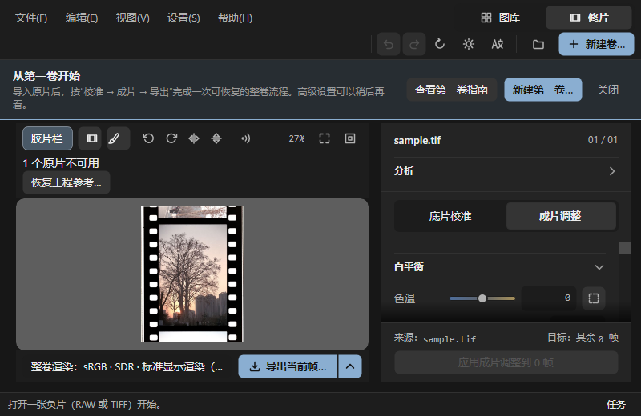
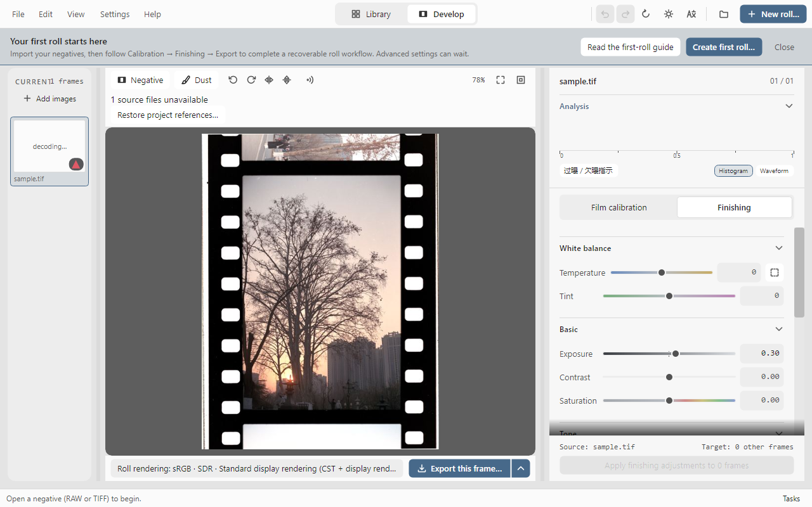

# 并排工作区与窄窗动作可达性

2026-11-12，NegPy 路线 M1 第五项实现。

## 布局规则

旧布局在宽度小于 1100 时，把参数栏放在预览下方，整个工作区纵向滚动。现在所有支持尺寸保留预览与参数并排，参数区独立滚动，当前帧、页签和批量动作保持固定。

- 宽度 1240 以上保留宽侧栏与完整胶片栏。
- 1000–1239 使用较窄胶片栏与 340px 参数栏。
- 1000 以下默认收起胶片栏，参数栏约 320px；预览工具栏的“胶片栏”按钮可临时展开和收起。左右切帧等原有导航保持可用。
- 窄窗顶部菜单／工作区切换与快捷动作分成两行，避免新建卷等按钮被截断。
- 高度小于 650 时暂时折叠辅助分析区；可以手动展开。恢复到较高窗口时恢复进入矮窗前的分析展开状态，不改直方图／波形选择、HDR 或裁切参数。
- 裁切提示受预览实际宽度约束，应用／取消排在说明下方。修复了窄窗下按钮越过预览、被参数栏挡住的问题。

布局是显示状态，不写入工程，不修改源像素、参数、选中帧或扫描分格身份。宽窄切换仍保留当前窄窗胶片栏选择；窗口内未引入覆盖原生预览的抽屉。

## 证据

生产 MainWindow、实际主题与演示图像，在中文／英文、浅色／深色各执行一轮 800×520 → 1000×700 → 1280×800 → 1440×900 → 800×700，合计 20 个完整工作区状态。

自动检查预览、参数区、导航动作和底部同步按钮均在窗口内；参数滚动区至少 90px；正常预览不小于 240×140；检查帧与曝光、扫描分格未被缩放改变。每个 800px 状态使用真实鼠标打开／关闭胶片栏，再确认三栏边界。800×700 时还检查除尘入口、裁切应用／取消可见与取消退出裁切状态。





演示原片路径刻意不存在，截图中保留“原片不可用”与首卷引导，以检查额外提示占用下的布局；照片仅用于呈现，不作色彩正确性依据。

复现：

```powershell
dotnet run --project docs/gui-audit/preview/Preview.csproj -c Release -- artifacts/negpy-workspace --workspace
dotnet run --project docs/gui-audit/preview/Preview.csproj -c Release -- artifacts/negpy-gui-regression
```

上述为实现时的工作区和既有窗口检查。分组重置已按用户要求撤回；精简后的最新回归见 [收尾记录](../negpy-optimization-progress.md)。

本次为 Headless 控件与逻辑像素验证，不覆盖物理多 DPI、屏幕阅读器、系统标题栏、真实 RAW 交互延迟、原生 GPU/HDR 叠层和三平台窗口管理器。M1 的真实用户任务与设备验收仍未完成；双软件等效桌面任务对照仍未完成，已有组件测量不代替此项。

2026-11-12 精简复测：撤回命名版本、复杂 A/B、历史、参数查找、分组重置和计数后，20 个工作区状态及既有窗口检查再次通过，以上工作区截图已替换为本次输出。
