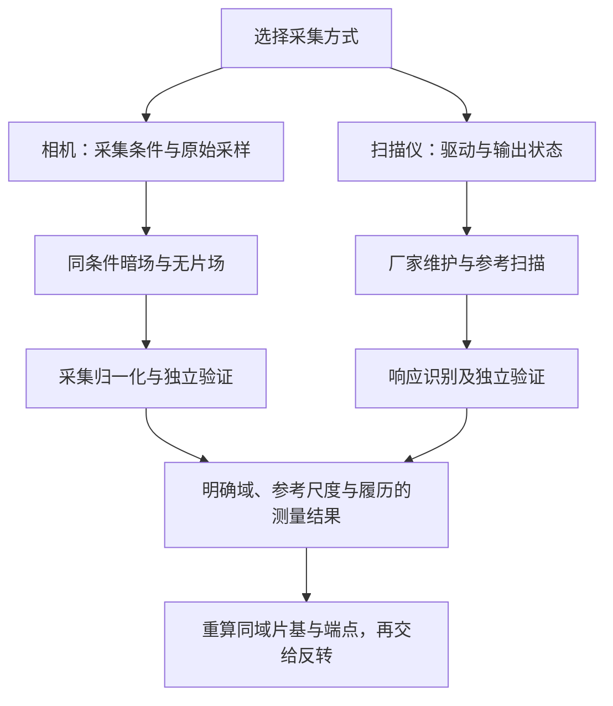

# 相机与扫描仪物理采集校准：双流程设计

日期：2026-11-18。取代将两类设备视为同一种 dark/open 向导的方案。统一职责是物理采集测量，负片片基、胶片反转、冲洗与正片观感由后续管线处理。

本轮实现范围：分设备结构化配置、分设备界面字段与指引、配置兼容和测试。下述校正计算、参数提取、参考匹配和验证算法为后续实现设计；当前没有“验证通过”或“应用到卷”的运算能力。

实现进展：相机 Bayer 原始读取与 dark/open 试算已落地，见 [实现记录](camera-cfa-dark-open-implementation.md)。另已实现 [扫描仪参考响应拟合和素材引导](scanner-response-and-collection-guide.md)，可在明确参考范围内检查误差，但仍无通用“设备验证通过”身份或“应用到卷”。

## 1. 总体结构

两条路共享资产摘要、版本、验证记录、适用条件解析、失效与输出容器；不共享强制参考清单或未声明的计算公式。普通原片始终可以沿既有未校准路径导入。

## 2. 相机翻拍流程

### A. 建立采集会话

记录机身／序列号、镜头、光圈、ISO、曝光、倍率／片架／位置、灯板及工作模式、解码策略。当前界面保存的是用户记录，后续从 RAW 提取证据与用户声明分别保存，不能把手填值当作已经核验。

第一版计算固定曝光和增益；变更条件后重新检查配置。曝光归一化跨档处理为后续独立能力，不能简单按 EXIF 快门比例推定所有条件相容。

### B. 取得参考

- 暗场：同设置遮光采集，用于偏置／暗信号；不进入胶片反转。
- 无片场：保留光路、片架和采集平面，移除负片，记录各通道照明响应。
- 平场：只有具有独立作用定义时才另行使用；无片场已校正空间响应时不再叠加同一 LCC。
- 验证数据：独立重复采集及有物理参考的透射阶梯／目标。校正所用参考和验收参考分开。

不将同卷片基替代无片场；片基含胶片本体的吸收，属于后续反转参考。参考不要求胶片冲洗标准化。

### C. 建立设备相对透射测量

从明确的原始计数取得 `sample`、`dark`、`open`，在同一电平合同内计算 `(sample-dark)/(open-dark)`；明确黑电平是否已扣除。所有参考与内容共享 CFA、active area、通道、定向和解码规则。保留原传感器范围证据，不能从缩小预览推断全部源饱和。

输出为设备通道透射率；保留光源和传感器谱响应身份，不套 camera→sRGB 矩阵制造所谓中性 RGB。解马赛克方法必须记录并在验证及实际处理间一致。非 Bayer 支持需单独实现，不能假装通用 CFA 解码已覆盖。

### D. 验收与保存

检查参考分母、坏点／饱和、重复性、稳定条件下的比例、空间残差与噪声传播。对浓负片不设通用亮暗淘汰阈值；只有有源证据的不可测量／异常位置携带质量标记。不能用反转后观感调优采集参数。

有谱或标准目标时，另外生成“指定响应表征”资产，而不是修改基础归一化的定义。模型适用域、误差及参考必须随资产保存。

## 3. 扫描仪流程

### A. 先确认可得到什么输入

保存具体设备和软件／版本、透射或反射模式、分辨率、曝光／模拟增益、导出位深／传递曲线／颜色设置、驱动扣黑和空间／白校准状态（未知、未执行、已执行）。硬件型号相同而软件或模式不同，不能直接共用配置。

后续按证据而非文件扩展名选择路径：

1. **原始设备数据可得且参考可控**：可建立相容 dark/open，但不要求所有扫描仪支持。
2. **驱动已校正的线性设备通道**：保留其校正，使用已测量目标验证及建立残余响应；不再次盲目扣黑／白归一化。
3. **仅得到 gamma／ICC 转换后的输出**：先识别已有处理及是否可可靠恢复设备响应。普通 ICC 逆变换或“去 gamma”本身不能证明无损恢复；做不到时只保存来源，继续普通导入，不声称得到物理透射率。

VueScan 官方区分扫描与颜色处理步骤，其 [RAW 输出](https://www.hamrick.com/vuescan/html/vuesc33.htm)和 [文件格式](https://www.hamrick.com/vuescan/html/vuesc24.htm)需分别解释，不能把所有 TIFF 当作相同线性设备数据。

### B. 厂家维护与参考材料分开

先按具体型号说明书执行用户可用的厂家硬件维护，不由本软件伪造驱动内部操作。某些设备已自动执行透射白校准，例如 [Flextight X1/X5 手册](https://cdn.hasselblad.com/a99c4b40-9059-4122-afd2-04e004395e55_x1-x5-scanner-manual-v1.5_eng.pdf)区分透射自动白校准与反射白校准，因此不能要求用户对这类输出再做同一处理。

物理响应验证优先寻找能放入片架、带测量值与测量条件的透射阶梯／透射目标。例如 [Stouffer 官方透射阶梯产品](https://www.stouffer.net/TransPage.htm)与 [产品清单](https://stouffer.net/Productlist.htm)提供不同形状／校准选项。应确认实际购买版本、逐阶数据、测量域和不确定度；标称阶差不等于单件实测，灰阶密度也不自动证明彩色三通道标准密度。

IT8 色靶及 ICC 继续作为输入色度来源资料；若其数据只有 Lab／XYZ，不纳入物理透射率／密度拟合。供应商及批次查询见 [材料指引](device-calibration-materials.md)。型号帮助选择片架和获取设备文档，目标编号才用于匹配测量参考。

反射稿模式单独登记，不运行胶片透射率公式；第一版物理计算仅面向透射负片。界面保留反射模式是为避免来源混淆，不表示提供反射率校准引擎。

### C. 响应验证与可选修正

扫描同一参考的独立重复，关闭可关闭的反相、自动端点和创作处理；不可关闭的处理记录并限制适用范围。用匹配 ROI 对比已知参考量：逐通道比例、单调性、浓度端噪声、杂散光迹象及空间／条纹残差。

若确有独立参考，可拟合有约束的每通道响应或指定参考域变换。只在验证范围内使用；不能用图像内容统计填补缺失的 dark/open 或强制把未知扫描输出归一到 0–1。阶梯可用于响应验证，也可用于有证据的参考尺度标定，但不能单凭一条中性阶梯建立彩色串扰模型。

只有独立验证通过的模型才可作为可执行资产。资料不足时状态为“参考不足／处理未知”，不是“扫描仪不支持普通导入”。

## 4. 统一输出与接入

计算模块未来输出：测量域与通道定义、参考尺度、像素／质量标记、采集及校正履历、配置／参考摘要、算法版本、适用条件、验证结果和未知的不确定度声明。设备通道、指定谱透射、标准密度分别有不同身份；不同设备原生 RGB 不直接逐值比较。

参考完整性、条件相容、测量验证、实际应用四个状态分别记录。原始资产保存、未应用、参考变更、条件不匹配、验证失败应可区分；没有数据时不显示“通过”。

接入反转前先适配其密度输入域；若输出已经是密度，禁止再次盲目取 log。配置变更后重算片基、端点及准备缓存，完整预览、区域与导出共用同一解析选择。第一次接入应显式保留旧路由，不静默给旧工程套用新配置。

## 5. 实施次序

1. 本轮：双流程配置和指引；Camera / Scanner 分开结构化保存，同一窗口仅显示当前类型字段，切换保留另一类草稿字段。旧配置缺失字段保持未知。
2. 相机：原始采样边界、黑电平所有权、参考匹配与 dark/open 数学测试，再接入实际数据。
3. 扫描仪：输出证据解析、驱动处理合同、物理参考数据与 ROI 测量；先验证可测性，再拟合修正。
4. 共用：可执行资产版本、独立验证、应用状态、失效与反转参数重建。

不先加跨设备通用矩阵，也不因增加配置字段就宣布两条校准计算已完成。
