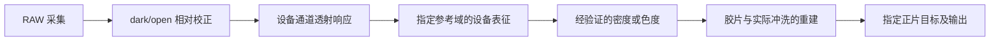

# 采集校正能否保证颜色准确：物理边界与 NexFilm 核查

日期：2026-11-18。NexFilm 对照版本为当前稳定版 [v1.2.0](https://github.com/BillyDu-TJ/NexFilm/releases/tag/v1.2.0)。本文是源码与文献研究，不是设备实测报告；不修改默认像素算法。

## 1. 结论与“准确”的目标

dark/open 可以改善满足条件的采集测量，不能独自保证标准颜色，更不能保证原场景重建。追加矩阵或 ICC 后，可以在明确参考域、材料与采集范围内获得经过验证的误差，但不存在仅凭“已应用校正”就成立的通用色准结论。

必须区分三个参考：

- 负片本体在指定照明／观察条件下的颜色：可用透射色度参考验证，但仍是负片的颜色。
- 标准密度或指定透射响应：需要对应的光谱加权、仪器或密度参考；相机通道 log 不自动成为 Status M／APD。
- 原拍摄场景的正片颜色与曝光：还需胶片、曝光、冲洗响应以及重建／渲染目标。若目标是印片外观，还涉及所选择的外观链，而不是唯一的物理正片。

[ACES 的 APD 定义](https://docs.acescentral.com/encodings/apd/)明确规定光谱响应；[Input Transform 定义](https://docs.acescentral.com/system-components/input-transforms/)说明普通输入变换的场景相对曝光目标。两者不是同一目标。



## 2. 为什么 dark/open 后仍不等于标准颜色

在近似线性、同曝光、稳定光源、无饱和且可忽略场景相关杂散光的条件下，第 i 通道可表示为：

```text
sample_i(x) = b_i(x) + g_i(x) × ∫ L(λ,x) τ(λ,x) s_i(λ) dλ
open_i(x)   = b_i(x) + g_i(x) × ∫ L(λ,x) s_i(λ) dλ
dark_i(x)   ≈ b_i(x)

T_i(x) = (sample_i-dark_i)/(open_i-dark_i)
       = ∫ L τ s_i dλ / ∫ L s_i dλ
```

这是推导使用的简化前向模型：实际读出、暗电流、噪声、黑电平处理与镜头光谱响应需要独立核查。g 与 L 中的固定空间乘性因素可在适用条件下抵消，但灯板光谱形状和传感器谱响应仍在积分里。归一化不是逐波长除去光源，也没有将传感器响应换成人眼或标准密度响应。

一个只说明机制的合成例子：同一胶片在两个波段的透射率为 0.1、0.9；某通道的归一化谱权重为 0.8、0.2，测得 0.26；换成 0.2、0.8，测得 0.74。两次 open 都被归一到 1，样本响应仍不同。此例不是完整 RGB 设备的色差模拟，不用于推断任何具体相机误差。

dark/open 能抵消适用条件下的偏置与空间增益；不能修复已经截断的信息，不能消除随机噪声，也不能自动消除内容相关的镜头 flare。参考帧本身的噪声和分母接近零还会放大误差。[扫描仪实测研究](https://link.springer.com/article/10.1007/s11760-025-04569-8)显示 flare 会影响密度／色调再现；该结果不能直接量化我们设备的误差。

## 3. 有设备参数或矩阵后，可以准确到什么程度

### 3.1 已知光谱与传感器响应

知道 L 和 s 能建立前向模型并设计转换，却不等于从三个积分恢复任意透射谱。对任意谱都存在精确 3×3 RGB→XYZ 的条件是采集响应与目标颜色匹配函数满足相应线性张成关系；实际相机一般不精确满足。[Zhu 与 Finlayson 的原始研究](https://pmc.ncbi.nlm.nih.gov/articles/PMC7730262/)给出该 Luther 条件及相机偏离情况。

胶片染料是一组受限制的材料，模型可能在这组材料上远优于对任意光谱的表现，因此不能反过来断言“RGB 永远做不准”。正确做法是限定胶片／材料、密度与光源范围，用独立实测报告可达误差。光源或传感器某波段响应很弱时，算法无法无条件补回缺失信息。

### 3.2 透射色靶与 ICC

用已知色度的透射靶建立 ICC，可验证对该参考及相近材料的颜色映射；参考白点、照明、观察者和解码处理必须一致。它描述的是透射原稿颜色，不自动描述原场景，也不自动解出负片染料层。反转片靶对其他染料材料的外推需要验证。[ArgyllCMS](https://www.argyllcms.com/doc/Scenarios.html)指出测试材料与设备谱响应的相互作用会引入颜色误差。

### 3.3 窄谱及多谱采集

若几束已知窄谱光和传感器混合响应可被可靠标定，可在有限波段模型下求通道分离；分时采集便于单独测量各光束响应。有限带宽、谱尾、噪声、条件数和胶片散射仍需验证。三个波段不自动成为标准密度或原场景 RGB；更多独立波段可以支持更丰富的谱重建，但也不是无条件的精确性证明。

### 3.4 冲洗不可控

冲洗不可控不影响为“现在这张负片”做设备校正，但影响从记录密度到原曝光的映射。若无同卷已知颜色／曝光参考，只能使用有范围限制的胶片模型或统计估计；若有参考，可拟合这次实际胶片＋冲洗的联合响应，不要求先控制成标准冲洗。没有参考时不应将所有偏色归咎于采集设备。

## 4. NexFilm v1.2.0 实际采用的方案

### 4.1 Smart Auto：默认估计路径

[raw_backend.rs](https://github.com/BillyDu-TJ/NexFilm/blob/v1.2.0/src/raw_backend.rs) 中 `NormalizedAsShot` 保留相机 as-shot 增益比例，并以最强主通道归一；它不是 UniWB，也不是硬件测量校准。相同通道增益可在同域片基相除时抵消，但有量化、截断或跨帧增益不同就不能无条件保证等价。

相机 RAW 的 Camera Native RGB 用于片基与密度计算，正片归一化后再使用 camera→display 矩阵及高光、gamma、曲线等。参见 [main.js shader](https://github.com/BillyDu-TJ/NexFilm/blob/v1.2.0/ui/main.js#L2638) 和 [实际实现增量](https://github.com/BillyDu-TJ/NexFilm/blob/v1.2.0/data_process_pipeline_doc.md#132-相机-raw-的相机原生密度基底)。DNG／扫描输入有其他输入域分支，不能把全部文件都描述为这一条 RAW 路径。

相机普通颜色矩阵有其线性采集信号语义，对经过密度及端点变换的正片信号不自动成立；将它后置是可实测的显示近似，不能仅据“来自相机型号”推断场景颜色已恢复。此处是我们的模型适用性判断，不是宣称对方已经在真实目标上失败。

### 4.2 Capture Corrected：暗场与无片场

[raw_backend.rs](https://github.com/BillyDu-TJ/NexFilm/blob/v1.2.0/src/raw_backend.rs#L304) 在 CFA 采样上执行 dark/open 公式，核验相机、ISO、曝光、active area、CFA 等，传播坏点、饱和及无效分母标记，再用固定 Bayer 双线性策略解马赛克；不是对普通预览图做近黑筛选。

其 [capability_resolver.rs](https://github.com/BillyDu-TJ/NexFilm/blob/v1.2.0/src/capability_resolver.rs#L368) 明确返回 `relative_transmission_no_measured_density`、`generic_positive_render`；flat 可保存但标记 `stored_not_applied_pending_independent_definition`。该路径改善了可追踪的设备透射测量，不表示标准密度或最终色准已完成。

### 4.3 Capture Characterized：用户参考色块拟合

已核查 [commands.rs](https://github.com/BillyDu-TJ/NexFilm/blob/v1.2.0/src/commands.rs#L2446) 的模型实际应用和 [calibration_fit.rs](https://github.com/BillyDu-TJ/NexFilm/blob/v1.2.0/src/calibration_fit.rs#L254) 的拟合计算：

1. 从 dark/open/target 获取 Camera Native transmission，用户给出 patch 坐标及参考。
2. 接受 `TransmissionRgb`；`DensityRgb` 先转换为 `10^-D`；拒绝把 `PcsXyzIccRgb` 或原生设备量冒作该目标域。
3. SVD 最小二乘拟合 `T_target = M × T_capture + b`；默认 b 为零，可选偏移。
4. 至少 4 个训练 patch；启用偏移至少 5 个，并要求至少 1 个验证 patch；检查秩、条件数及留出误差。
5. 模型在 log 之前实际应用，保存测量摘要、参数与诊断。失效可退回仍有效的 dark/open。

它不是自动从设备型号生成矩阵，也不是拿普通 IT8 的 Lab／XYZ 填表就能执行的方案。`TransmissionRgb` 仍需有光谱权重、归一化及测量来源，否则只有目标域名字，没有独立物理真值。`DensityRgb` 转换后拟合的是透射域模型，不是密度域的矩阵映射。

默认条件数上限 `1e5`、验证 RMSE 上限 `0.08` 是实现门槛，后者属于线性透射率绝对误差，不是 ΔE 或密度误差。作为数学例子，T 从 0.01 变成 0.02，绝对误差仅 0.01，却对应约 0.301 D；所以该阈值不能单独证明浓负片色准。仅一个留出 patch 也不等于经过独立设备／胶片／曝光验证。

### 4.4 完成度与证据限制

[真实硬件验证清单](https://github.com/BillyDu-TJ/NexFilm/blob/v1.2.0/docs/p1.1-real-hardware-validation-checklist.md) 在发布标签中仍将 Capture 标为实验性且默认关闭，声明合成测试不建立真实硬件／胶片密度准确性；其仓库状态段日期为 2026-09-08，不能据此推断作者没有在仓库外做过任何实验。

[技术文档](https://github.com/BillyDu-TJ/NexFilm/blob/v1.2.0/data_process_pipeline_doc.md)明确尚无 Density Calibrated、胶片 H-D 重建及新的 Status M 矩阵。因此目前能确认的是“已实现参考驱动的采集校正与拟合”，没有足够证据将它升级为“经认证的端到端颜色准确”。部分旧统一管线说明仍写 ProPhoto 共用基底，与 v1.2.0 新增 Camera Native 分支不完全一致；本核查优先采用标签中的实际代码与较新实现说明。

## 5. 对我们的实施决定

设备模块应分别表达“参考已登记”“采集已归一化”“指定参考域已表征”“卷级重建已验证”，其中后三项必须有实际计算和验证依据，不能因保存配置自动提升状态。采集校正前后都不默认宣称最终正片更准确。

第一步的计算目标仍是设备透射响应一致性；之后明确选择标准密度、透射色度或原场景重建中的哪一个目标。保留原始读取与采集校正对照，使用独立灰阶、彩色透射目标、不同密度和重复采集验证。透射率、密度、色度及最终正片各用自身参考指标，不能用任一层训练误差替代其他层。

高密度区域同时检查相对透射率／密度误差与噪声传播，不能只看绝对 T RMSE；颜色比较需统一白点与目标域，并覆盖训练外材料和独立采集。冲洗未知时，设备验证仍可进行，场景重建则保持估计身份，直到取得同卷参考。

结论：可借鉴 NexFilm 的层次划分、参考约束、测量摘要和失效回退；不直接采用其通用数值门槛，也不照搬后置相机矩阵作为色准证明。当前我们实现的配置库尚未执行任何上述采集校正，因此暂时既没有改变采集颜色，也不能宣称校正后准确。
