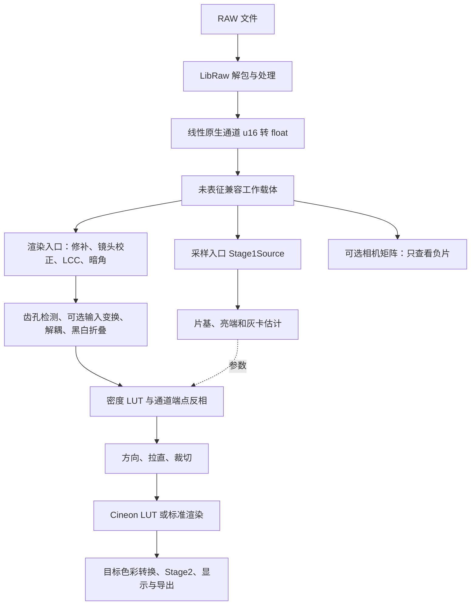

# 采集管线与参考数据核查：第一阶段

日期：2026-11-18。代码基线：`eaf2e4230becf680d88732bcce9c3ac861c3c348`。

本阶段仅核查当前实现、参数来源和后续需要的参考数据，不修改像素算法，不生成标定参数。结论来自静态代码追踪；未在本阶段进行设备实测或画质对照。适用范围为当前工作区，不代表外部采集素材已完成盘点。

后续范围修正（2026-11-18）：用户明确普通 RAW 只负责忠实解码与传递；本文件第 6 节涉及采集质量门槛、设备重复性和参考适用性的工作移入 [独立设备校准模块](device-calibration-module.md)。普通输入不凭亮暗阈值筛选有效像素，第 2 阶段以 [解码完整性](../performance/decode-integrity-2026-11-18.md) 为准。

## 1. 实施约束与结论

设备自身参数、光源资料和产出图像在有条件时可获得；标准冲洗不可控。因此应分别管理可复用的设备／光源配置、卷级负片参数、以及有独立参考时才成立的卷级联合重建。胶片型号是先验，不能替代该卷冲洗响应的验证。

当前默认 RAW 路径在线性相机原生通道中计算密度；不是默认先转 ACEScg 再反相。其输入来源明确标记为未表征兼容透传。后续 ACEScg 工作载体、Cineon 编码、ICC 输出不能单独证明原场景颜色已恢复。

本次发现的重点：

1. `TBase` 新值通常为 `[1,1,1]`，片基通过 `DMinPerChannel` 表达；旧工程及部分路径仍可携带其他参考。不能把 `TBase` 字段名直接当作当前片基采样存储位置。
2. `DMaxPerChannel` 是渲染亮端，可能由自动分析、手选高光或中性灰放置推导，不等于胶片物理最大密度。
3. LibRaw 已扣黑并缩放为 16-bit；桥接固定线性输出与 UniWB，但仍保留最大值调整和 clip 策略，不能把解码浮点值视为未经处理的传感器计数。
4. LCC 是均值归一化的空间校正，不是带暗场的绝对无片场归一化。
5. 采样、整图渲染和区域渲染有独立预处理入口；尤其 LCC 与镜头校正组合、密度模式解耦需要下一阶段验证。

与既定方向的关系见 [数字中间片输入标定](digital-intermediate-input-calibration.md) 和 [RAW/TIFF 审计](../raw-io.md)。不增加相纸工作流，不更换现有 Cineon LUT 输入契约。

## 2. 当前实际执行顺序

图中 F 的输入变换在 `InputPrimaries == null` 时跳过，当前 GUI `BuildParams` 不设置它。工程或其他调用方可以携带非空值，应独立覆盖。

### 2.1 RAW 解码与采集数值

证据：[原生桥 or_raw_process](../../packaging/libraw/bridge.cpp)、[RawDecode](../../src/OpenRevelare.Core/RawDecode.cs)、[RawColorMetadata](../../src/OpenRevelare.Core/RawColorMetadata.cs)。

| 项目 | 当前执行行为 | 测量边界 |
| --- | --- | --- |
| 白平衡 | `use_camera_wb=0`、`use_auto_wb=0`、四个 `user_mul=1` | 不施加相机／自动白平衡；不等于没有扣黑与缩放 |
| 颜色与传递 | `output_color=0`，gamma 参数为线性 | 默认不施加相机到显示 RGB 的矩阵 |
| 亮度和亮部 | 禁用自动亮度，`bright=1`；`highlight=0`、`adjust_maximum_thr=0.75` | 需审计处理前后电平与饱和；禁止再次盲目扣黑 |
| 数值载体 | LibRaw 输出 16-bit，托管侧按 `1/65535` 转 float | float 不恢复上游量化／截断损失；不是无片场实测透射率 |
| 解马赛克 | 全尺寸 AHD；Preview 使用 half-size；可选 FBDD | 全尺寸、代理、区域与参考的处理策略要记录；half-size 下 FBDD 不生效 |
| 可选后端 | Windows 可经 Adobe DNG Converter 转线性 DNG，再走读取；Auto 有条件救援 | 不能把转换后端与直接 LibRaw 当作完全同一测量策略 |
| 颜色身份 | `RawCameraNative`、`LinearInCaptureChannels`、`LegacyTreatNumbersAsWorking` | `LinearAcesCgV1` 载体不表示输入已表征 |

相机矩阵经 `CameraCharacterization.ToWorking` 用于负片查看，默认不进入密度反相。已有电平诊断记录与量化间距估算，不能代替逐像素质量掩码。

### 2.2 TIFF、扫描 FFF 与扫描 DNG

这是独立输入分支，不能套用 RAW 原生域结论。[TiffIO](../../src/OpenRevelare.Core/TiffIO.cs) 按输入契约解释 ICC／文件声明及回退策略；[ScannerDng](../../src/OpenRevelare.Core/ScannerDng.cs) 和 FFF 内容判断参与路由。

扫描软件是否已施加黑电平、曲线、锐化和颜色调整，不能仅由扩展名判定。后续参考数据需附导出设置及来源配置；现有 ICC 管理仍保留，但“已按 ICC 解释”不等于负片密度已标定。

### 2.3 反相前校正和采样入口

证据：[Pipeline.ProcessFrame](../../src/OpenRevelare.Core/Pipeline.cs)、[RegionRender](../../src/OpenRevelare.Core/RegionRender.cs)、[MainViewModel.Stage1Source / BuildParams](../../src/OpenRevelare.Gui/ViewModels/MainViewModel.cs)。

整图路径依次执行：自动灰尘修补（启用时）、内嵌镜头或 Lensfun 校正、手动畸变、条件性 LCC、手动暗角、手动灰尘修补、齿孔阈值掩码检测、可选输入变换、解耦、黑白折叠，再交给 `Inversion`。几何方向／拉直／裁切位于反相后。

`Stage1Source` 不做几何畸变和灰尘修补；优先 LCC，否则内嵌暗角，否则 Lensfun 暗角，再做手动暗角、线性解耦、黑白折叠。它调用来源有效性检查，但该检查不能替代设备与参考的物理适用性验证。

需后续验证的入口差异，尚不在本轮认定为已复现故障：

- 整图／区域路径仅在未启用对应镜头路径时应用 LCC，采样入口优先 LCC；应检查镜头校正内部如何处理 LCC，枚举有效组合后再判断像素域是否一致。
- `Stage1Source` 固定线性解耦；Core／工程可携带 `DecoupleMode.Density`。GUI `BuildParams` 固定线性，但不能据此排除所有旧工程／直接调用组合。
- `Decouple.ApplyDensity` 以传入缓冲区 p99 估计参考；同图全幅与区域缓冲区的统计范围不同，需专门验证区域一致性。
- 非空 `InputPrimaries` 在 Core 反相前执行，采样入口未应用；若开放此路径必须统一采样域并重算参数。
- 灰尘修补、几何重采样和 RAW half-size 都可能改变采样统计，须按测量目的选择基准，而不是要求所有预览像素逐位相同。

### 2.4 LCC 和分光解耦

证据：[Lcc](../../src/OpenRevelare.Core/Lcc.cs)、[Decouple](../../src/OpenRevelare.Core/Decouple.cs)、[DecoupleCalibration](../../src/OpenRevelare.Core/DecoupleCalibration.cs)。

LCC 参考被缩小、平滑、逐通道除以均值，再作为空间除数应用；低值受 `1e-3` 保护。它保留空间亮度／颜色不均匀的形状，移除了各通道平均曝光与色比。因此不能把它当作 `(sample-dark)/(open-dark)` 的完整实现，未来引入 open-gate 时需避免重复消除空间响应。

Path A 默认在 log 前乘解耦矩阵。当结果接近非正值时，代码向原值混合以保护正值；实际变换是带保护的非线性操作，应统计触发次数及范围，而不能只验理想矩阵。`DecoupleChromaMatrix` 则在端点归一化后的密度色度中生效，两者并非同一域的可互换矩阵。可选 C-41 色度补偿也不构成标准密度认证。

## 3. 参数所有权与密度表达

证据：[FrameParams](../../src/OpenRevelare.Core/FrameParams.cs)、[Inversion](../../src/OpenRevelare.Core/Inversion.cs)、[DensityEndpoints](../../src/OpenRevelare.Core/DensityEndpoints.cs)、[FilmBase](../../src/OpenRevelare.Core/FilmBase.cs)。

| 参数／对象 | 当前来源和用途 | 后续应保存的依据 |
| --- | --- | --- |
| `TBase` | 新工程通常为 1；旧工程仍可保留不同值，参与 `-log10(v/TBase)` | 参考尺度、旧工程版本；不能与 D-Min 重复扣片基 |
| `DMinPerChannel` | 手选片基 `-log10(tb)` 或自动估计结果；用户也可调整 | 实测／估计／用户修改、ROI、源帧及前处理身份 |
| `DMaxPerChannel` | 高光采样、自动亮端估计、中性灰码值放置或用户调整 | 推导方法和目标放置；不声称物理最大密度 |
| `OutputRange` | 固定 `(1032-95)*0.002 = 1.874` | 编码／渲染约定，非设备动态范围 |
| `DensityEndpoints` | `a=s*D+b`，每通道把黑端映射到 `-OutputRange`、亮端到 0 | 端点有效性与参数来源 |
| `LccFlatField` | 校正用参考的均值归一化空间场 | 原参考、输入解码策略、采集条件与内容摘要 |
| `DecoupleMatrix` | Path A 参考估计；GUI 固定线性模式 | 参考图、ROI、采集设置、域及保护触发情况 |
| `DecoupleChromaMatrix` | 本卷解耦前后统计的色度补偿 | 不作为独立标准密度拟合；记录所依赖卷内容 |
| `InputPrimaries` | 默认未设置；非空时于反相前变换 | 仅凭相机 ColorMatrix 不能填成已标定输入 |

默认 `TBase=1` 时，片基扣除已经体现在端点仿射的偏移中。不得在新实现中再独立扣一次 `DMin` 后复用原偏移。代码注释中的“绝对密度”在这里仅指相对于解码归一化参考 1 的坐标；未测无片场时，不是经仪器标定的绝对光学密度。

`Inversion` 在 `[0,1]` 使用 65536 项密度 LUT（索引取最近格），大于 1 直接算 log；非正输入会走索引／密度安全下限保护。端点后做指数输出。保护能产生有限图像，不代表异常输入成为了有效测量。当前并无全链路逐像素测量质量传播。

## 4. 渲染、版本与失效边界

`PrepareFilm` 克隆参数并以 `OutputIntent.None` 停在物理／几何阶段；`PreparedFilmFrame` 保存像素和填充掩码。`RenderPreparedFilm` 拷贝像素再完成渲染，上游兼容性仍由调用方负责。

`ManagedV2` 主要完善输出与 LUT 色彩管理，不能据版本名推断输入已经表征。标准渲染与 LUT 渲染有各自转换；维持现有 Cineon 输入契约，不把场景 RGB 的任意 log 当作同一信号。

后续必须追踪源文件版本、解码后端／设置、采集校正、片基／端点、解耦及几何对准备缓存的影响。创作参数与输出目标原则上只使后段失效；解码或采集校正变化则需重新采样／估计及准备。当前已有缓存和来源检查，本阶段不声称它们完全缺失，也未逐项证明它们已覆盖新增标定资产。

## 5. 已有证据清单与缺失参考

本清单仅盘点仓库可见资产；不扫描工作区之外的个人照片，也不把脚本中提到的外部路径当作已取得素材。

| 可见资产 | 用途 | 不能证明的事项 |
| --- | --- | --- |
| [docs/calibration](../calibration/README.md) 的研究脚本 | 历史模型、输入基色／串扰候选和反例 | 不能直接作为当前设备／胶卷的通用标定；部分研究涉及相纸链路 |
| [docs/performance](../performance) 的基准报告 | 时间、缓存、像素一致性和版本对照 | 性能记录不是独立密度／场景颜色真值 |
| 测试中的合成输入、ICC patch TIFF 和显示夹具 | 输入契约、编码及回归验证 | 不代表真实 RAW 暗场、无片场、灯板光谱或实际胶片响应 |
| `InputAuditTests`、`LibRawRuntimeTests`、端点及解耦测试 | 已有行为的回归证据；见 tests 目录 | 本轮未运行，不声称当前测试通过或覆盖所有设备 |
| `audit-input` CLI 和 [使用说明](../raw-io.md) | 后续原片审计入口 | 单张原片内部审计不能给出绝对色准 |

后续采集按可得性分组，不要求控制标准冲洗：

| 数据组 | 最低记录内容 | 可验证目标 |
| --- | --- | --- |
| 设备／光源资料 | 设备、镜头、灯板、工作模式；光谱／响应注明厂商、实测或推断 | 确定适用条件；色温不能替代 SPD |
| 同片重复采集 | 同一块负片、固定机位的重复 RAW；ISO／快门／光圈及时间 | 重复性、漂移和空间一致性 |
| 同片不同翻拍曝光 | 同一底片位置，多档曝光，保留片基，避开饱和 | 曝光比例与净密度一致性；不要求知道原场景 |
| 暗场／无片场／平场（有条件） | 同条件采集，各自说明作用、曝光和几何 | 偏置、空间响应、可用测量范围；不重复扣黑／校正 |
| 每卷片基 | 同卷未曝光区域，源图与 ROI；是否人工确认 | 卷级净密度零点与估计偏差 |
| 同片跨设备采集（可选） | 同一物理片、各自设备与参考 | 设备间一致性，不自动代表场景真值 |
| 已知透射／密度目标（可选） | 参考测量域、证书／光谱、批次和不确定度 | 指定测量域下的设备表征 |
| 拍到胶片上的颜色／曝光参考（可选） | 参考目标、原拍摄光照／曝光、同卷身份、冲洗信息可未知 | 该卷胶片＋冲洗的联合重建；独立样本验证后才讨论复用 |
| 实验室或软件输出正片（可选） | 输入对应关系、软件／设置、ICC、已知调色 | 外观匹配；不作为未经论证的场景真值 |

每组素材至少记录：稳定 ID、文件摘要、采集会话和卷 ID、角色、设备与光源信息、曝光／ISO／光圈、已知处理、参考值及来源、ROI 与坐标系、重复／曝光配对关系、可用性及缺失原因。未知值保留未知，不用型号默认值伪装实测。冲洗记录可为空，不能因此拒绝基础采集一致性验证。

## 6. 下一阶段范围与验收

下一阶段先建立采集质量基线，复用已有 `audit-input`，再决定是否扩展其报告；不先加入颜色矩阵。

1. 对可获得的原片记录处理前后电平、饱和／近黑／非有限计数及有效采样面积；在支持的阶段明确何时已无法反推传感器饱和。
2. 用同片重复和不同曝光配对，比较同域片基归一化的密度；保存配准 ROI 与排除原因，不把逐图自动重新拉端点后的一致当作测量一致。
3. 枚举 LCC、内嵌／Lensfun、线性／密度解耦、非空输入变换、全幅／代理／区域路径，核查采样值与实际反相输入。先复现再修复本次列出的差异风险。
4. 在查看结果前确定允许误差、噪声门槛及场景范围。数值阈值须由设备精度、重复性和用途确定，本阶段不虚构通用通过值。

第一阶段完成条件：源码路径与参数含义可追踪；现有证据和待采参考分开；冲洗不可控的边界写清；像素算法、默认参数和旧工程路由保持不变。本轮只满足静态核查，不声称完成设备标定或独立色准验证。
