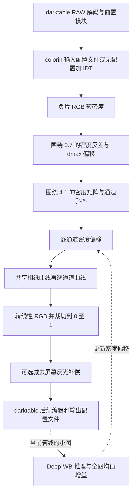
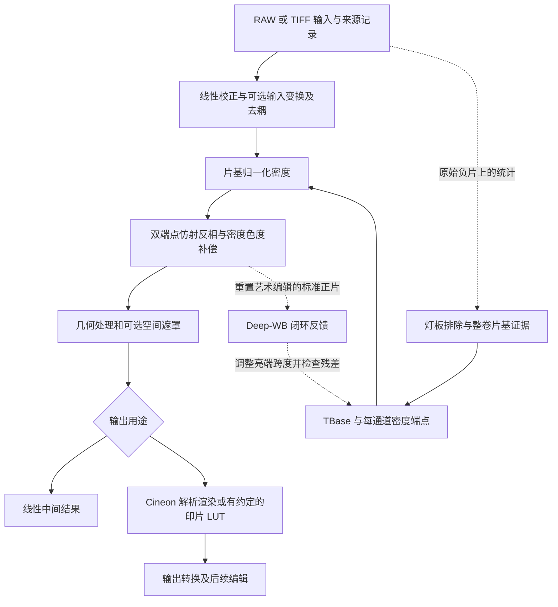

# DARKTABLE-DIVERE 负片模块调研与 OpenRevelare 对比

调研日期：2026-10-11。对象为 Kaixi2004/DARKTABLE-DIVERE 的固定提交 `ec6bcbf4fa0faec5bc6a03d83e3382be7c165586`，对照 darktable `release-5.6.2`。OpenRevelare 对照本地 `a9f27652d52f316bd6b4608aae0fb92c2d63789e` 加当前工作区修改；齿孔默认行为与识别改进包含尚未提交的修改。

证据包括源码对照、提交历史、参数与调用链检查，以及可复算的标量数值实验。**没有构建运行 DARKTABLE-DIVERE，也没有在同一组原始照片上进行画质盲测或性能测试。**以下将“源码确定的行为”“数学推论”“待实片验证的收益”分开描述。

## 1. 判断与采用建议

**2026-10-11 用户确定的方向：OpenRevelare 采用数字中间片思路，目标是提高颜色准确性；不引入相纸渲染，保留现有 LUT 路径。下一步优先解决输入设备颜色标定。**对方的数字暗房流程仅作为比较对象，不作为本项目的产品目标。

它的突出价值是把 DiVERE 的密度反相、密度校正矩阵和多种印片材料曲线放进 darktable 的完整摄影工作流。对愿意手动调色、追求暗房式印片外观的用户，这种组合有吸引力。OpenRevelare 的优势则集中在整卷片基估计、证据置信度、双端点校准，以及校准与输出渲染的分离。

优先借鉴顺序：

1. **输入设备颜色标定优先**：明确设备、灯板、解码与测量域，验证与片基和端点联合标定的路径。
2. **明确密度校正来源与适用条件**：结合已有线性去耦和密度色度变换，不把固定 Status M 矩阵当成通用相机校正。
3. **按用户目的组织 UI**：输入标定、负片校准、LUT 外观与输出边界清楚；沿用方向、齿孔、裁切及同步布局要求。
4. **保留 LUT 路径及其输入输出契约**：外观不参与标定拟合，不用相纸曲线补偿设备误差。AI 快速模式不属于当前优先工作。

具体下一步见 [数字中间片输入标定方向](digital-intermediate-input-calibration.md)。

本次源码审计确认了一个重要阻碍：**七种 Ilford MGFB 的共享曲线均为降序控制点，而处理函数要求升序；直接移植会带入错误。**另有 AI 输入约定、早期硬裁切、旧项目迁移和全局 CPU 回退等需处理的问题。

## 2. 项目定位：它改的是哪一个负片模块

该仓库基于 darktable，实质上替换了 `negadoctor` 的参数和算法，并修改输入配置文件模块 `colorin`、输出模块 `colorout`，附带相纸曲线、JSON 色彩空间与 Deep-WB 模型。它不只是给原版 negadoctor 增加几个预设。[仓库说明][repo]、[模块实现][negative]。

原版 negadoctor 的用户工作流包含片基采样、动态范围、扫描曝光和印片调节；此分支的新参数没有保留同等的片基采样参数。原版文档可用于理解差异，**不能直接作为这个分支的操作说明**。[原版说明][stock-doc]。

需要特别澄清两个名称：

- **digital mask / 数字 mask**：这里是作用于每个像素 RGB 密度的 3×3 矩阵，不是齿孔、灯板或空间遮罩。
- **IDT、Status M 矩阵、相纸曲线**：分别涉及负片输入 RGB 声明/转换、密度域校正、输出印片外观；三个位置即使出现相同的 Kodak 名称，也不能互换。

因此，它不能直接解决此前的“无齿孔片基被扣白”问题。该问题仍应在空间识别、片基证据、保守拒判和默认行为上解决。

核查时仓库有四次提交；最新提交说明涉及 Endura 导出全黑的 CPU 回退。虽然提交信息提到官方原样，实际比较当前、初始及整合提交的 `negadoctor.c`，三个文件 SHA256 相同，自定义负片算法仍在。判断以源码为准。[固定提交][commit]。

## 3. 两套处理流程

### DARKTABLE-DIVERE



### OpenRevelare



图中是逻辑边界，省略了各模块内部细节。OpenRevelare 的 RAW 来源可能是明确记录为未标定的兼容输入，不能因为工作缓冲区名称包含 ACEScg，就认定相机输入已获得准确的色度学标定。详见第 7 节。

## 4. 功能与取舍对比

| 维度 | DARKTABLE-DIVERE | OpenRevelare 当前实现 | 判断 |
| --- | --- | --- | --- |
| 核心反相 | 全局密度反差、dmax 偏移，另叠加通道修正 | 显式 TBase 与每通道两端密度，统一仿射映射 | 手动塑形对方直接；测量、参数独立性本项目更清楚 |
| 片基 | 新模块无显式 TBase / 片基采样参数 | 整卷统计、物理边缘与模式证据、内容推断、置信度 | 本项目更符合整卷自动处理，仍会受片基缺失与过曝影响 |
| 跨通道校正 | 显式 3×3 密度矩阵，默认 Status M to Print Density | 已有线性去耦矩阵、密度色度矩阵及相关校准路径 | 不是“对方有矩阵、我们没有”；应比较域、基准和标定证据 |
| 暗部/亮部颜色 | 通道密度斜率与逐通道偏移 | 两端校准与亮端跨度反馈 | 本项目端点约束更明确；双方都需防止参数间竞争 |
| 相纸/印片外观 | 14 种材料曲线加无曲线选项，覆盖彩色和黑白 | 解析 Cineon 渲染、印片 3D LUT、版本化输出约定 | 相纸语义和黑白号数值得补足；不能把 1D 曲线等同完整印片模型 |
| 自动白平衡 | 低分辨率单次网络，当前管线全图均值反馈 | 标准正片输入、闭环亮端跨度、保留最好残差 | 对方计算量可能较低；本项目控制更完整，真实质量仍待比较 |
| 高光余量 | negadoctor 内逐通道裁切到 0–1 | 核心支持扩展线性数值；输出分支有各自范围政策 | 中间数据和后续恢复本项目更灵活，最终 SDR 同样需映射 |
| 色彩输入 | 可选 JSON IDT，仅在无输入配置路径生效 | ICC TIFF 有管理路径；RAW 保留未标定兼容来源 | 对方入口值得学习；两者都不能凭空间名称保证测量准确 |
| RAW 编辑生态 | 可组合 darktable 的解码、编辑、历史与样式 | 专用胶片批处理应用 | 对方宿主能力更广，本项目任务路径更集中 |
| CPU/GPU | 自定义负片模块 CPU；当前 colorout 也强制 CPU | 核心 CPU，已有 LUT 和缓存等优化 | 没有同机实测，不能断言哪边更快 |
| 旧项目 | 原版 v2 负片参数迁移成新默认值 | LegacyV1 / ManagedV2 分离，保留输出语义 | 本项目更重视旧效果稳定；仍需持续回归验证 |
| 齿孔处理 | 此处的数字 mask 不承担空间识别 | 独立空间检测和用户开关，当前修改默认关闭 | 对方不是该问题的直接参考实现 |

本项目依据：[Pipeline.cs](../../src/OpenRevelare.Core/Pipeline.cs)、[Inversion.cs](../../src/OpenRevelare.Core/Inversion.cs)、[FilmBase.cs](../../src/OpenRevelare.Core/FilmBase.cs)、[DensityEndpoints.cs](../../src/OpenRevelare.Core/DensityEndpoints.cs)、[ColorPipeline.cs](../../src/OpenRevelare.Core/ColorPipeline.cs)、[MainViewModel.cs](../../src/OpenRevelare.Gui/ViewModels/MainViewModel.cs)。

## 5. 反相数学：差异主要在约束，而不是有没有取对数

### 5.1 对方的基本模型

忽略安全下限、矩阵、颜色偏移及相纸，令输入透射 RGB 的某通道为 `T`，密度为 `d = -log10(T)`，反差为 `g`，最大密度参数为 `m`：

```text
a = 0.7 + (d - 0.7) × g - m
positive = 10^a
```

因此它是密度域的一次仿射映射。`m` 增加 1，会将这一步的线性亮度缩小到十分之一；`g` 同时改变密度跨度和围绕固定支点的亮度关系。其“最大密度”是处理模型中的偏移参数，不能直接理解为对当前胶片最大密度的测量。

实现先从 `a` 指数化，再取负对数进入后续密度处理。没有触发数值下限时，这一往返可以代数化简；若移植，宜直接保留密度量，避免重复超越函数，但必须验证极暗输入处的下限语义。[处理函数][negative-process]。

### 5.2 本项目的模型

```text
d = -log10(T / TBase)
span[c] = max(dMax[c] - dMin[c], ε)
a[c] = R × (d[c] - dMin[c]) / span[c] - R
positive[c] = 10^a[c]
```

这里 `R` 是固定输出密度范围。每通道 `dMin` 映射到 `-R`，`dMax` 映射到 `0`，两端定义直接决定仿射系数。所谓黑端、白端是反相核心中的参考端点，**不意味着最终显示值一定为纯黑、纯白**；相纸或显示渲染仍会决定外观。

两套基本模型属于同一类仿射反相。对方优势在于用熟悉的反差与偏移手动塑形；本项目优势是测量端点具有清楚的约束。若为界面方便引入“反差”旋钮，应把它作为明确的用户调节映射，而不重新引入一套与端点并列竞争的校准自由度。

### 5.3 “分层反差”不等于复杂的局部色调模型

当前源码的通道 gamma，是围绕固定密度支点的逐通道仿射斜率；不是按图像空间区域分层，也没有在该步骤实现独立的多段暗部/中间调/亮部曲线。矩阵和斜率能改善某些颜色关系，但“分层”一词不应被解读为额外的局部适应能力。

反相 gamma、矩阵、通道斜率、RGB 密度偏移和相纸曲线可以补偿彼此。这给专家更多控制，也提高调节顺序和认知成本。最终看起来平衡，不等于中间量已获得物理标定。

## 6. 值得借鉴的三个主要部分

### 6.1 相纸渲染及黑白号数：对方特征，不纳入本项目

相纸预设提供七种彩色印片材料和七种 Ilford MGFB 号数；数据结构先应用共享 RGB 曲线，再应用 R/G/B 曲线。这比仅叫作“曲线”或“对比度”的入口更贴近暗房用户的操作语言。[曲线数据][curves]。

潜在收益包括黑白影调选择、不同 toe/shoulder、彩色印片材料外观，以及更容易理解的预设比较。不过，这些分离的一维曲线只描述有限的通道响应；不自动包含染料相互作用、光谱响应、纸面反射、观察光源或完整三维色域行为。预设叫“2383”也不能据此保证真实 2383 印片匹配。

原调研曾建议增加 `PaperRender`，用户明确数字中间片方向后，**该建议撤回，不进入实施路线**。以下条目仅说明审查这类渲染时所需的技术条件：

- 相纸选择只改变渲染，不回写 TBase、端点、输入标定或自动白平衡。
- 为曲线记录名称、版本、来源、输入密度约定、归一化范围和输出 RGB/色度约定。
- 显式定义本项目的 Cineon/端点归一化量到相纸输入量的适配；不能直接套用对方的 `log10(65536)` 归一化。
- 初版采用严格验证的分段线性插值或预计算 1D LUT，明确端外延拓政策。
- 用灰阶、颜色和高光检查数据与公式，而不以预设数量作为验收指标。

本项目继续使用具有明确契约的 LUT，不增加相纸选择和号数界面。相纸曲线审计保留为对方实现的研究证据。

### 6.2 可选密度矩阵，但要有标定域

对方显式暴露矩阵，支持单位矩阵、Status M 到打印密度以及自定义。这使跨通道校正可检查、可关闭，优于把所有颜色问题隐含交给饱和度或白平衡。

但相机 RGB 取对数，不会自然变成 Status M 密度。灯板光谱、胶片染料、相机滤色阵列和前置白平衡都影响坐标系。固定矩阵适用的前提应被验证，而非默认由名称满足。

数值检查该默认矩阵的行和为 `1.0605 / 0.9402 / 0.9832`。因此，对离开支点的等 RGB 密度，矩阵不保持等 RGB；这可能符合目标打印密度的设计，**本身不是错误证据**，但说明它不能无条件当作保持中性的通用去串扰矩阵。

本项目已有线性光去耦及密度色度变换。真正应补的是“矩阵在哪里、基于什么设备与材料拟合、如何与端点共同约束”的工作流，而非再添加九个默认滑块。[本项目校准记录](../calibration/README.md)已经记录过：共享相纸链路会混淆“所有胶片通用串扰”的结论，不能重复这一推断。

建议先做离线标定实验：比较线性去耦、密度域矩阵和二者组合；用独立验证色块、不同曝光与不同胶片检查是否过拟合。若成立，再保存设备、光源、输入处理、密度定义和参考材料等元数据。矩阵插入端点前后会影响已校准端点，必须联合求解或显式保护约束。

### 6.3 按操作目的组织界面

对方分为“密度反相 / 应用修正 / 相纸”三页，方向正确：用户按任务寻找，而不是理解整条数学管线。AI 与颜色修正放在一起，相纸与外观放在一起，值得学习。[GUI 实现][negative-gui]。

不足是矩阵九项直接占据主要页面，且通道 gamma 的 tooltip 声称默认值为 `0.000`，实际参数默认值为 `1.0`。对于不了解密度的用户，名称和数值语义不一致会造成明显负担。

本项目宜保留简单的“片基与校准 → 自动/手动色偏 → 渲染外观”顺序；详细矩阵留在专家入口。方向处理及其同步继续靠近负片/对比；齿孔开关保持可见且独立同步；原几何折叠区继续仅承载裁切相关功能。无需为了模仿它的三页布局重新隐藏常用操作。

## 7. 已确认的问题和边界

### 7.1 七种 Ilford 曲线的控制点顺序错误：确定，可复算

`_interp_linear` 先比较第一个点和最后一个点，随后沿升序区间查找。`negadoctor_curves.h` 的七组 Ilford 共享 RGB 控制点却全部降序。`commit_params` 直接选取常量数组，没有排序转换。[插值函数][negative-interp]、[控制点][curves]。

Ilford MGFB 2 的第一个 x 为 `0.801177...`，最后一个 x 为 `0.325514...`。因此：

- 所有 `x ≤ 0.801177...` 都提前返回第一个 y。
- 剩下的 x 必然也大于最后一个 x，提前返回最后一个 y。
- 内部插值循环永远无法处理实际区间，整个函数只剩两个常数。

按源码公式复算共享曲线对应的线性输出（省略常量舍入误差；该预设的通道曲线为恒等曲线）：

| 归一化输入 | 原始顺序输出 | 将点按 x 排序后输出 |
| --- | --- | --- |
| 0.20 | 0.94784 | 0.00813 |
| 0.40 | 0.94784 | 0.00777 |
| 0.60 | 0.94784 | 0.01787 |
| 0.80 | 0.94784 | 0.94789 |
| 0.90 | 0.00813 | 0.94784 |

这是曲线函数的退化与反向跳变，不是审美偏好。结果代表局部公式复算，未声称是完整 darktable 截图或导出实测。

排序能修复区间查找，但原始测量点的 y 仍有轻微非单调变化，是否需要保形拟合应另行判断，不能把“排序后”直接认定为物理正确的标准曲线。

### 7.2 Deep-WB 输入色彩约定不匹配：路径确定，影响待验证

AI 回调以 `DT_COLORSPACE_LIN_REC2020` 导出当前管线的小图，再将其数值直接乘 255 转 8 位输入。这个路径没有先转换成 sRGB 编码。随后长边约 128 像素推理，以输入/输出的全图通道均值形成修正，再按 `density_gamma / 2` 缩放并叠加到密度偏移。[AI 回调][negative-ai]。

Deep-WB 原始工作针对已渲染照片的白平衡编辑，官方训练说明使用 Rendered WB 数据集。把线性广色域输入直接当作这类照片数值，是需要验证的分布改变。[Deep-WB 官方仓库][deepwb]。

仅看中性 18% 线性灰：直接量化约为 `46/255`，正确 sRGB 编码约为 `118/255`。这只能说明编码差异显著；该中性样例并不证明网络一定产生某个方向的色偏。非中性色还涉及 Rec.2020 与 sRGB 基色不同。

其他边界：当前输出包含管线中启用的编辑；没有在此路径独立定义灯板、纯边框和高光等统计排除；全图均值会随构图改变。导出和推理直接在按钮回调中执行，存在阻塞 UI 的风险，尚无延迟实测。连续点击是增量更新，不是显式残差收敛求解。

本项目在 GUI 的 `BuildDeepWbRenderParams` 中重置艺术编辑，并以标准正片反馈亮端跨度，保存最好一轮、设置最大 30 轮和停止阈值，推理在工作线程。优点是约束和反馈较清楚；代价是更复杂、可能多次推理，而且网络仍是图像先验，不能代替灰卡和物理测量。不能仅凭闭环便宣称画质更好。

若研究快速模式，先统一输入编码、视场与统计范围，再比较单次初值、当前闭环及混合模式，避免将小图分辨率差异误当成算法优势。

### 7.3 模块内逐通道硬裁切：确定的功能取舍

负片模块在相纸处理后将线性 RGB 限制到 0–1，即使选择无相纸曲线也如此。超过上限的不同高光数值会变成同一个值，后续降低曝光无法恢复这些差别；逐通道截断也可能改变高饱和高光的色相。[处理函数][negative-process]。

对于直接 SDR 印片外观，这是明确且简单的输出选择；对于浮点中间文件、后续大幅调色和 HDR 延伸，则过早。OpenRevelare 核心允许扩展线性量，ManagedV2 的不同输出目标再规定范围；这项架构应保留，不能把对方的末尾 clamp 搬到反相公共核心。

### 7.4 屏幕反光补偿实际改变导出像素：确定

参数处理是 `max(0, linear - glare/100)`，不是仅预览显示补偿。例如 2% 会把线性 `0.01` 和 `0.02` 都压到零，把 `1.0` 变成 `0.98`。对想压深黑位的用户有创作用途，但名称容易让人误以为不影响文件。

本项目若借鉴，应根据用途明确命名为渲染黑位调整，或放在仅预览的显示校准层，不要以“屏幕补偿”名义隐含改变导出。

### 7.5 色彩输入：对方有入口，本项目也有未完成之处

对方 JSON 提供 Kodak 2383 和 Endura Premier 基色及 D60 白点。`colorin` 仅当输入配置为“无配置”时使用所选 IDT；正常配置文件路径不叠加 IDT。这避免重复转换，但 UI 必须解释生效条件。[colorin][colorin]、[Endura JSON][idt]。

这些命名的色彩空间不是一份针对任意相机加灯板的实测输入标定。选择一个空间，和证明当前设备测量处于该空间，是两件不同的事。此外，启用非 1 的 IDT gamma 时，处理先把输入限制到 0–1 再取幂，会影响扩展数值。

**OpenRevelare 同样不能宣称输入问题已经解决。**当前 RAW 的 `AdmitRawWorking` 明确记录为相机原生、未标定、兼容透传；`InputPrimaries` 支持转换，但常规 RAW 路径并未自动填写设备标定。ICC TIFF 的转换、输出 ICC 的准确性，也不能补出 RAW 设备本来没有提供的负片测量标定。

这比增加一种相纸预设更接近底层颜色准确性的瓶颈。建议增加真实的输入标定选择、来源提示及独立验证样本；研究时同时比较无配置、相机配置和胶片翻拍专用标定，不预设哪种对所有光源与胶片都更好。[RawDecode.cs](../../src/OpenRevelare.Core/RawDecode.cs)、[InputTransform.cs](../../src/OpenRevelare.Core/InputTransform.cs)。

### 7.6 兼容与执行策略

旧版 negadoctor v2 参数迁移时被替换成 DiVERE 默认值，旧 Dmin、WB、曝光等没有保存为同等处理效果。这意味着原版旧编辑历史可能改变。不同参数语义无法一一转换可以理解，但用户项目需要明确迁移提示或并行保留旧实现。[迁移代码][migration]。

当前自定义负片模块没有 OpenCL 实现。`data/kernels/negadoctor.cl` 与所对照的官方版本相同，文件存在不代表新算法在 GPU 上运行。

最新 `colorout` 为处理部分 GPU 上的 Endura 导出问题，无条件令 `process_cl_ready = FALSE`。优点是优先确保正确输出，代价是 CPU 回退范围覆盖所有 colorout 情况；具体性能影响待同机测量。不能据此推断整个 darktable 都禁用了 GPU。[colorout 修复][colorout]。

源码声称 CPU 能保证 bit-exact，但跨语言、编译器、数学库、重采样和 ONNX Runtime 的逐位一致性不能由“CPU only”推导出来。OpenRevelare 的 ONNX 后端已明确指出 PIL 与 ImageSharp 重采样及运行库差异，不承诺逐像素一致；应继续以明确数值容差和最终校准量验收。

### 7.7 资产来源说明有不一致，需要区分代码与模型

该仓库 README 将 DiVERE 算法、相纸和白平衡模型一起描述为 MIT；Deep-WB 原始仓库给出的许可则是 CC BY-NC-SA 4.0，并说明仅供研究、不能商业使用。本项目 `models/README.md` 也将该模型单独列出。[对方说明][repo]、[Deep-WB 许可][deepwb-license]。

这足以说明**不能仅凭衍生仓库的 MIT 描述推断模型权重的授权**。本次未下载并核对两边模型权重哈希，也没有确认对方是否获得独立授权，所以不作权重同一性或侵权结论。任何直接引入模型、曲线资产前，应分别记录真实来源与相应许可；算法思想、代码实现和模型权重分开处理。

## 8. 建议实施路线与验收条件

| 优先级 | 工作 | 目的 | 进入产品的条件 |
| --- | --- | --- | --- |
| P0 | 输入测量链路与参考数据审计 | 保证拟合对象和目标可解释 | 明确设备、光源、RAW 解码、参考域及片基；排除带相纸外观的混淆数据 |
| P1 | 输入标定与密度矩阵离线对照 | 验证颜色改善来自哪里 | 同一光源和设备有留出色块；不同曝光/胶片也报告结果；确认与端点约束兼容 |
| P1 | 标定资产与失效机制 | 使标定可追溯、可复用 | 保存来源、适用域、版本和哈希；输入改变后重建相关校准；旧工程保持版本路由 |
| P1 | 精简 UI 与有效状态提示 | 降低认知负担 | 用户能分清校准、色偏、外观；IDT/矩阵生效状态清楚；常用开关及同步容易找到 |
| 后续 | AI 快速初值与闭环对比 | 控制延迟，保留可解释反馈 | 输入标定完成后另行评估，不作为本轮颜色准确性的替代方案 |
| 后续 | 标定变换预计算 | 保证交互 | 先确定公式及误差预算，再测实际瓶颈；不优先移植整套 C/OpenCL 模块 |

不建议直接采用：统一默认 Status M 矩阵、与端点并列的新 gamma/dmax 校准参数、核心强制裁切、导出随屏幕反光设置变化、旧项目重置默认值、未经输入约定核查的 Deep-WB 预处理。

UI 改进不能通过把所有功能一律隐藏来实现。普通用户应能看到当前是否启用齿孔处理、采用何种渲染和自动修正是否成功；矩阵数值、曲线域及设备标定细节才适合专业入口。

## 9. 公平的实片验证方案

至少包含彩色橙色片基、浅色或近中性片基、黑白片、有/无齿孔、边缘不完整、灯板过曝、强色偏、肤色与高饱和颜色、低对比和高反差画面。此前反馈的无齿孔原始输入应单列为回归材料。

分四步比较，不能把所有预设一起打开后只凭观感归因：

1. **只比较反相**：尽量使用相同的线性输入、裁切、曝光和颜色声明，关闭相纸、艺术编辑及 AI；记录每通道中性轴和端点。
2. **只比较跨通道校正**：固定相同反相端点，比较单位矩阵、Status M、设备标定矩阵及本项目现有去耦；区分训练色块与验证色块。
3. **只比较渲染**：同一反相结果比较解析输出、1D 相纸与现有 3D 印片 LUT；分别评价灰阶、toe/shoulder、色相和主观偏好。只有物理参考及观察条件明确时，才报告有意义的色差。
4. **比较完整工作流**：同样图片、同机、相同输出尺寸与配置文件，记录用户操作时间、推理/导出延迟、重复运行一致性及跨帧稳定性。

客观指标与外观偏好分开：中性轴偏差、已知参考下的色差、灰阶连续性、提前截断比例、空间误遮罩率、跨帧校准离散度，以及用户盲选结果。对原始灯板/片基识别，漏检和把画面错误扣白应分别计数，并优先控制后者。

没有相同条件的实片实验，目前能够支持的是结构、数学约束及实现可靠性的比较，不能支持“对方颜色更准”或“本项目画质全面更好”的排名。

## 10. 复算方法与证据索引

标准库脚本 [audit_darktable_divere.py](audit_darktable_divere.py) 下载固定版本源码、验证负片处理源文件 SHA256、检查全部 56 组曲线数组，并复算 Ilford MGFB 2 的插值行为：

```powershell
python docs/research/audit_darktable_divere.py
```

离线使用已有源码目录：

```powershell
python docs/research/audit_darktable_divere.py --source-dir C:/path/to/DARKTABLE-DIVERE
```

本次实际运行确认：56 组数组中，七组 Ilford RGB 数组不满足升序；MGFB 2 在归一化输入 0.4 与 0.6 得到相同的约 0.94784 线性输出，而输入 0.9 降至约 0.00813。脚本不是完整的应用回归测试或图像质量基准。

本项目比较入口：

- [FilmBase.cs](../../src/OpenRevelare.Core/FilmBase.cs)：物理片基证据与内容推断。
- [DensityEndpoints.cs](../../src/OpenRevelare.Core/DensityEndpoints.cs)：双端点映射。
- [Inversion.cs](../../src/OpenRevelare.Core/Inversion.cs)：片基归一化与密度色度处理。
- [Pipeline.cs](../../src/OpenRevelare.Core/Pipeline.cs)：处理顺序及版本化输出。
- [RawDecode.cs](../../src/OpenRevelare.Core/RawDecode.cs)：RAW 来源与未标定兼容路径。
- [ColorPipeline.cs](../../src/OpenRevelare.Core/ColorPipeline.cs)：Cineon、LUT 及输出约定。
- [MainViewModel.cs](../../src/OpenRevelare.Gui/ViewModels/MainViewModel.cs)：标准 AI 正片与闭环控制。
- [OnnxDeepWbCorrector.cs](../../src/OpenRevelare.DeepWb.Onnx/OnnxDeepWbCorrector.cs)：模型边界与运行库差异说明。
- [校准实验记录](../calibration/README.md)：矩阵、输入基色及相纸混淆因素。
- [模型来源说明](../../models/README.md)：模型与程序分开的授权记录。

[repo]: https://github.com/Kaixi2004/DARKTABLE-DIVERE/blob/ec6bcbf4fa0faec5bc6a03d83e3382be7c165586/README.md
[commit]: https://github.com/Kaixi2004/DARKTABLE-DIVERE/commit/ec6bcbf4fa0faec5bc6a03d83e3382be7c165586
[negative]: https://github.com/Kaixi2004/DARKTABLE-DIVERE/blob/ec6bcbf4fa0faec5bc6a03d83e3382be7c165586/src/iop/negadoctor.c
[negative-process]: https://github.com/Kaixi2004/DARKTABLE-DIVERE/blob/ec6bcbf4fa0faec5bc6a03d83e3382be7c165586/src/iop/negadoctor.c#L444-L559
[negative-interp]: https://github.com/Kaixi2004/DARKTABLE-DIVERE/blob/ec6bcbf4fa0faec5bc6a03d83e3382be7c165586/src/iop/negadoctor.c#L404-L441
[negative-ai]: https://github.com/Kaixi2004/DARKTABLE-DIVERE/blob/ec6bcbf4fa0faec5bc6a03d83e3382be7c165586/src/iop/negadoctor.c#L872-L958
[negative-gui]: https://github.com/Kaixi2004/DARKTABLE-DIVERE/blob/ec6bcbf4fa0faec5bc6a03d83e3382be7c165586/src/iop/negadoctor.c#L964-L1083
[migration]: https://github.com/Kaixi2004/DARKTABLE-DIVERE/blob/ec6bcbf4fa0faec5bc6a03d83e3382be7c165586/src/iop/negadoctor.c#L280-L310
[curves]: https://github.com/Kaixi2004/DARKTABLE-DIVERE/blob/ec6bcbf4fa0faec5bc6a03d83e3382be7c165586/src/iop/negadoctor_curves.h
[colorin]: https://github.com/Kaixi2004/DARKTABLE-DIVERE/blob/ec6bcbf4fa0faec5bc6a03d83e3382be7c165586/src/iop/colorin.c#L1481-L1517
[idt]: https://github.com/Kaixi2004/DARKTABLE-DIVERE/blob/ec6bcbf4fa0faec5bc6a03d83e3382be7c165586/data/color/json/KodakEnduraPremier.json
[colorout]: https://github.com/Kaixi2004/DARKTABLE-DIVERE/blob/ec6bcbf4fa0faec5bc6a03d83e3382be7c165586/src/iop/colorout.c#L582-L588
[stock-doc]: https://docs.darktable.org/usermanual/development/en/module-reference/processing-modules/negadoctor/
[deepwb]: https://github.com/mahmoudnafifi/Deep_White_Balance
[deepwb-license]: https://github.com/mahmoudnafifi/Deep_White_Balance/blob/master/LICENSE.md
