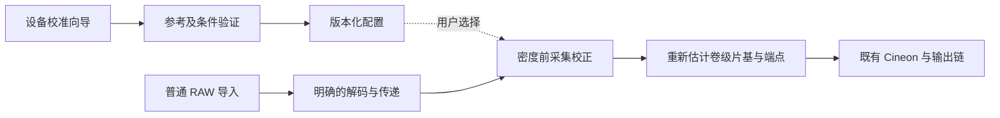

# 独立设备校准模块

日期：2026-11-18。状态：已实现参考配置库与用户入口，以及 [Bayer CFA dark/open 试算](camera-cfa-dark-open-implementation.md)。ICC 拟合、通用标准密度标定和配置应用仍未实现。普通 RAW 解码完整性与本模块分开交付。

后续实现：已增加 [扫描仪参考密度响应拟合及素材采集引导](scanner-response-and-collection-guide.md)。它是有条件的每通道响应模型，不是标准密度认证或 ICC 拟合；配置应用到胶卷仍未开放。

标准接入更新：新增 [IT8/CGATS、Argyll CTI3 与输入 ICC 导入](standard-scanner-assets-and-camera-instructions.md)，相机说明按实际拍摄操作组织，原密度 JSON 退为高级入口。标准产物不自动升级为物理密度能力。

最新范围：以 [物理采集校准边界](physical-capture-calibration.md) 为准。模块仅校准负片透射信息的物理采集，不包含胶片重建或正片颜色。常规 ICC 为输入来源资料；登记它不代表物理透射／密度已标定。

相机／扫描仪流程已拆分，见 [双流程设计](camera-scanner-calibration-redesign.md)。界面分类型保存相机光学与曝光设置、扫描软件及驱动校正状态；这些仍为用户记录，不自动构成验证证据。

## 用户入口和数据归属

提供独立“设备校准”入口：创建配置 → 指定设备与光源 → 导入参考 → 检查适用条件 → 预览校正效果与验证结果 → 保存配置。用户在胶卷中主动选择配置，默认不启用；单纯导入 RAW 不要求校准，也不凭直方图拒绝素材。详细数值放在模块的报告中。

配置属于设备、光源和采集条件，不属于胶片型号。卷级片基／端点和 SceneBase 仍独立保存。不可控冲洗不妨碍设备采集校正，但限制原场景重建的可辨识性。

## NexFilm v1.2.0 已实现且可借鉴的部分

本次按发布标签核查，以下均指代码能力，不代表对方完成真实设备精度认证：

- [raw_backend.rs](https://github.com/BillyDu-TJ/NexFilm/blob/v1.2.0/src/raw_backend.rs) 的 `correct_cfa_capture` 在 CFA 采样上计算 `(sample-dark)/(open-dark)`；检查 active area、CFA、相机、ISO 和曝光相容性。缺参考、坏点、无效分母及达到白电平等作为校准测量质量标记传播。这些标记有明确参考和原始电平依据，与普通解码预览的亮暗阈值筛选不同。
- 同文件的元数据摘要、几何指纹和固定 Bayer 解马赛克，使参考与内容的处理来源可追踪。固定双线性只是其策略，不作为我们默认更换 AHD 的依据。
- [capability_resolver.rs](https://github.com/BillyDu-TJ/NexFilm/blob/v1.2.0/src/capability_resolver.rs) 检查 profile／锚点的摘要和解码版本依赖，分层解析能力；某个端点或表征失效不必抛弃仍有效的采集校正。flat 为可选且报告未应用，不能照字段名声称已做平场。
- [calibration_fit.rs](https://github.com/BillyDu-TJ/NexFilm/blob/v1.2.0/src/calibration_fit.rs) 对参考域、训练／验证数据、秩和条件数作检查并保存测量摘要；数值门槛与模型不直接移植为我们设备的验收标准。

## 我们的实现顺序

1. **配置与向导。** 独立保存配置 ID、格式／算法版本、用户名称、设备与光源、镜头／几何、采集设置、解码策略、参考文件摘要、已执行操作、验证结果。状态按基础校正、设备表征分别记录，不用单一“已校准”布尔值。
2. **参考计算。** 增加与当前已处理 RGB 不同的 CFA 读取边界，保留原始电平及参考；审计扣黑所有权。不得直接把已由 LibRaw 扣黑／缩放的数据再次套原始 dark/open 公式。CFA 类型尚不支持时明确不可用，不静默换成另一策略。
3. **适用性与应用。** 检查内容帧与配置的设备、ISO、曝光、镜头、几何、光源声明和解码版本。第一版限定相容曝光，不能未经验证混用不同曝光的参考。缺信息或条件不匹配时说明原因，仍允许用户使用普通未校准路径。
4. **空间校正。** 先定义 open-gate 与现有 LCC／镜头暗角的所有权，再决定何者执行；避免重复空间归一化。设备配置切换使片基、端点及准备缓存失效，预览、区域、导出共享同一解析结果。
5. **测量表征扩展。** 仅有可信且域明确的透射／密度目标时增加拟合；不能将普通 ICC 的 XYZ／Lab 直接作为透射参考。设备采集校正不宣称 Status M 或其他标准密度已建立，除非在该参考域独立验证通过。胶片与实际冲洗的联合重建不在本模块内。

## 用户可理解的状态

显示“未使用设备配置”“采集校正已应用”“配置需要重验”及具体原因。已保存不等于已验证，已验证也不等于已应用；参考变化不能悄悄改写已打开工程。按层记录应用状态，允许无效设备表征退回有效基础校正，但任何回退都写入工程和报告并统一预览／导出。

## 验收边界

普通导入无需参考且保持既有结果。设备校准模块用已知构造数据测试计算、扣黑所有权、参考失配和质量标记；真实重复采集／曝光和独立目标验证只在模块中进行。设备配置可导入导出、缺参考可诊断、内容变更可失效、切换配置可撤销，旧工程不自动套用新配置。

现有 LCC、Path A、来源快照和技术报告为后续接入点，不将普通相机矩阵自动升级为设备透射标定。

## 已交付的配置库

Windows／Linux 从“设置 → 设备校准…”进入；macOS 从应用原生菜单进入。相机翻拍与扫描仪分别提供采集说明，可登记型号、序列号、采集条件、色靶批次、备注及多张参考，角色包括 dark、open-gate、flat、色靶图像、色靶参考数据、输入 ICC、光源光谱和相机响应资料。

配置存于用户数据目录 `device-calibrations`。引用外部文件并保存 SHA-256；核验只说明文件存在且内容一致，不声称参考条件匹配或颜色已标定。导出 JSON 不打包参考，包含本机完整路径；导入形成新草稿，不覆盖已有配置。损坏配置逐项报告，其余配置继续可用。配置尚不能被胶卷选为实际处理模型。

采集方法与材料渠道详见 [相机／扫描仪参考材料指引](device-calibration-materials.md)。

dark/open、设备表征与最终色准的区别，以及 NexFilm 默认／实验路径的源码核查见 [采集校正与颜色准确性](capture-calibration-colour-accuracy-2026-11-18.md)。配置保存不意味着这些验证已完成。
