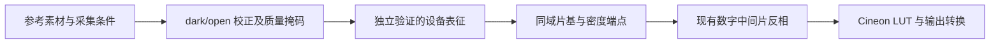

# NexFilm 硬件校准参考与数字中间片接入边界

调研日期：2026-10-11。NexFilm 固定版本：`d3d02a3cc0b3766d23642ba1020d6165d57a9314`，已通过 GitHub API 确认与调研时 main 一致。本次检查文档及调用链，未构建或执行 NexFilm，未进行真实硬件验证。

## 1. 结论

NexFilm 比 DARKTABLE-DIVERE 更直接对应当前的输入设备标定工作。值得借鉴的是采集层、密度层和胶片重建层分离，以及参考素材、质量掩码、独立验证和失效回退组成的完整标定生命周期。

它并非只有规划：暗场/无片场实际参与像素计算，用户目标驱动的 3×3 也接入了输入路径。但项目明确说明硬件校正仍为实验功能，仓库尚无真实设备端到端验证材料；Density Calibrated、Status M 和胶片 H-D 重建仍不能由当前能力推出。[路线图][roadmap]、[真实硬件验证清单][checklist]。

OpenRevelare 应吸收这些边界，保持自己的数字中间片、ACEScg 工作载体、Cineon/LUT 和输出契约。不能因借鉴硬件校准而引入相纸工作流，也不能把对方的 ProPhoto 载体或渲染窗口直接搬进来。

## 2. 已有实现与待完成事项

| 部分 | 核查结果 | 对我们的意义 |
| --- | --- | --- |
| 暗场/无片场 | CFA 域计算相对透射率，并检查参考的曝光、ISO、相机及几何一致性 | 输入测量校正应早于密度及创作处理 |
| 解马赛克 | 校正路径采用固定 Bayer 双线性方法，不附加相机白平衡或输出矩阵 | 同一组标定与照片必须共享可追溯的解码策略；不意味着双线性是最佳选择 |
| 质量状态 | 无效分母、负值、饱和、坏点等分别记录，保留掩码 | 数值安全下限不能把无效测量升级成有效数据 |
| Capture Separation | 用户参考色块的 SVD 最小二乘 3×3，可选偏移；独立验证后作用于 log 之前 | 可作为候选模型，不是已经证明通用的设备色彩解法 |
| Profile | 保存版本、素材摘要、硬件指纹、拟合与验证记录，并检查失效 | 标定应成为可追溯资产，而非九个裸参数 |
| 能力回退 | 拟合失效但 dark/open 仍有效时可保留基础采集校正 | 不应因某一层失效就丢弃其他有效信息 |
| flat | 可收集保存，当前明确记录尚未施加 | 避免与 open-gate 的空间归一化重复校正 |
| Scanner Input | 独立的输入配置，不自动提升 Capture 或 Density 能力等级 | 扫描仪 ICC 与相机采集校准应分开解析和验证 |
| 真实准确性 | 文档明确尚缺真实 RAW/设备及独立密度参考验证 | 合成测试和配置状态不能代替硬件实测 |

实现依据：[raw_backend.rs][raw]、[calibration_fit.rs][fit]、[commands.rs][commands]、[app_state.rs][state]。

## 3. 最应借鉴的测量边界

### 3.1 采集归一化不等于颜色表征

对方实现的基础关系是：

```text
T = (sample - dark) / (open_gate - dark)
```

在相容曝光、增益、几何及稳定光源条件下，它建立设备通道的相对透射响应，并可抵消部分暗信号与空间增益差异。它不能仅凭 dark/open 就求得胶片染料光谱、标准密度或场景颜色。

这一关系目前按同曝光检查，不应未经验证推广为任意曝光混用。不同曝光参考需要显式建立曝光比例、线性与噪声模型；尤其暗场也可能随曝光和温度改变。

对我们的接入要求：先审计 RAW 解码已施加的黑电平、增益和白平衡，避免二次扣黑。已有 LCC/暗角校正也必须明确与 open-gate 的作用分工，不能在两个位置重复消除同一个空间响应。

### 3.2 透射目标不能被普通照片色卡值替代

NexFilm 的拟合接受 Transmission RGB，或先将 Density RGB 转为 `10^-D`；它拒绝将 PCS/XYZ/ICC RGB 直接作为这一拟合的目标。[拟合实现][fit]。

这个限制有价值，但“Transmission RGB”标签本身还不充分。我们还需要参考通道的光谱定义、测量仪器/光源、绝对或相对归一化及不确定度。只有颜色空间名称而没有参考测量，不能保证拟合目标可比。

普通反射色卡的标准 Lab/XYZ 可用于合适条件下的场景颜色验证，但不能直接填入负片透射 RGB 拟合表。若用拍到胶片上的色卡反求整条负片链路，结果属于设备与胶片/冲洗的联合模型，不能冒充纯设备 profile。

### 3.3 不交换 log 两侧的矩阵

```text
-log10(A × T) != A × [-log10(T)]
```

采集分离矩阵、标准密度映射和正片工作空间转换必须各有明确源域和目标域。三者数值都是 3×3，也不能混用。

对于 OpenRevelare，不能仅把 Capture Separation 写进 `InputPrimaries` 并称为色度学输入配置。标准化透射量还需经过密度与胶片反相/重建，才能说明正片颜色的工作空间含义；工作缓冲区名称本身不提供测量依据。

### 3.4 无效数据与可显示像素分开

NexFilm 将无效输入保留为质量标记，避免用 epsilon 掩盖失败。我们可以借鉴该原则：片基采样、端点估计与矩阵拟合应排除无效测量；显示填充或修补是后续显示策略，不能再作为有效参考进入标定。

尤其应追踪饱和的 open-gate。它使分母测量不可信，不能因为最后得到有限 RGB 就继续宣称该像素已校准。

## 4. 拟合实现可借鉴，但验收不能照搬

其拟合具备明确参考域、训练/验证划分、退化秩与条件数拒绝，以及通道误差统计。矩阵模型至少需要四个训练色块，带偏移时至少五个，并至少有一个验证色块。这些是代码的最低门槛，不是充分的实验设计。

需要进一步改进的地方：

- 默认验证门槛是透射率绝对 RMSE `0.08`，不是色差，也没有给出适用于我们设备的误差预算。不能沿用它作为颜色准确性验收值。
- 暗部对透射误差敏感，应同时检查相对透射误差、密度误差、噪声放大和后续颜色误差，避免亮色块支配拟合。
- 不能只留一个验证色块；应覆盖颜色、密度、曝光及独立重复采集，防止同一张目标图的相关误差同时进入训练和验证。
- 参考值转换成透射率，并不让该模型变成 log 后的密度矩阵，也不自动建立 Status M。
- 全单位立方体的严格正值约束是保守策略，可能排除在真实样本范围有效的负系数模型；实际可接受范围、越界策略与保护函数必须联合验证。
- hardware fingerprint 和内容 digest 能检查记录是否变化，不能自动证明光源实际亮度/光谱没有漂移。需要重复参考与可观测的漂移检查。

以上是我们对模型适用性的评估，不是声称其代码已经在真实硬件上验证失败。

## 5. 对本项目的接入顺序



建议首阶段完成参考采集协议与 RAW 数据边界审计；随后以真实数据验证基础采集校正；再比较候选设备表征和联合密度模型。不能只实现 profile 管理页面就宣布颜色准确性得到提升。

本项目需要的资产约定可吸收 NexFilm 的设计：

1. 独立记录基础采集校正、设备表征与密度参考能力，不以一个“已校准”布尔值包办。
2. 保存参考内容哈希、解码/算法版本、硬件与光源条件、测量域、有效范围和留出验证结果。
3. 输入或标定变更后重建相关片基、端点、预览及导出依赖；不能只换矩阵继续使用旧端点。
4. 矩阵失效时保留仍有效的基础校正；若需要回到现有兼容路径，预览和导出必须采用同一已记录的选择，不能各自静默回退。
5. 主界面用“未标定 / 采集已校正 / 输入已表征 / 需要重验”等简洁状态，详细报告说明实际能力；不直接声称密度已标准化或绝对色准。

Scanner ICC 继续服从本项目已有 LittleCMS 文件输入政策；不得用对方自定义扫描配置替代当前完整 ICC 解析和转换。

## 6. 当前阶段限制

本次只完成源码与设计调研并补充输入标定准备，没有移植算法或修改生产处理路径，没有新增已完成功能的 changelog。缺少真实参考数据时不生成虚构标定参数。

[roadmap]: https://github.com/BillyDu-TJ/NexFilm/blob/d3d02a3cc0b3766d23642ba1020d6165d57a9314/docs/calibration-and-density-upgrade-roadmap.md
[checklist]: https://github.com/BillyDu-TJ/NexFilm/blob/d3d02a3cc0b3766d23642ba1020d6165d57a9314/docs/p1.1-real-hardware-validation-checklist.md
[fit]: https://github.com/BillyDu-TJ/NexFilm/blob/d3d02a3cc0b3766d23642ba1020d6165d57a9314/src/calibration_fit.rs
[raw]: https://github.com/BillyDu-TJ/NexFilm/blob/d3d02a3cc0b3766d23642ba1020d6165d57a9314/src/raw_backend.rs
[commands]: https://github.com/BillyDu-TJ/NexFilm/blob/d3d02a3cc0b3766d23642ba1020d6165d57a9314/src/commands.rs#L2316-L2450
[state]: https://github.com/BillyDu-TJ/NexFilm/blob/d3d02a3cc0b3766d23642ba1020d6165d57a9314/src/app_state.rs
