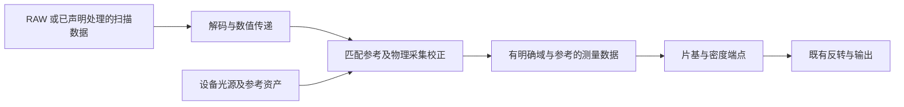

# 物理采集校准：收窄后的模块合同

日期：2026-11-18。用户确定的目标是让采集数据可靠表达负片的物理透射信息；胶片反转与正片表现交给既有反转流程。本文更新此前设备校准方案的职责，原研究中的色度及场景重建讨论不作为本模块验收目标。

相机与扫描仪的具体参考、处理所有权和双流程实现以 [双流程设计](camera-scanner-calibration-redesign.md) 为准；扫描仪不强制采用相机 dark/open 路径。

## 1. 输入输出边界

物理校正可改变测量值，但每个操作须由参考和物理目标支持。普通导入不要求设备配置；配置不参与创作 LUT、灰世界、中性化或逐画面统计拉伸。片基相减是后续业务操作，无片场不能被同卷片基替代。

## 2. 配置修改（已实现）

`DeviceCalibrationProfile` 新增：

- `MeasurementTarget`：设备通道相对透射率、指定光谱响应的透射率、指定标准密度。字段表示用户目标，不表示已达能力。
- `InputState`：未知、传感器原始采样、线性设备通道、已颜色转换像素。它是用户声明，后续必须对照实际解码证据核验。
- `MeasurementDefinition`：目标通道／标准名称、光谱定义、归一化尺度和参考来源的记录。
- `LightSource`、`DecodeRecipe`、`AlreadyAppliedCorrections`：分别记录光源、解码／扫描处理和输入已执行的校正，避免只凭“RAW”“TIFF”或“linear”判断可否扣黑。

旧版配置缺少新字段时，输入状态为未知，目标为设备相对透射率；不自动认定输入是 CFA，也不产生任何已验证状态。继续沿用草稿配置格式 1，新字段可选；未知枚举和未来格式仍拒绝。模块尚未生成／应用计算模型，因此不将这些声明作为可执行测量证据。

界面增加测量目标、输入状态和来源字段；输入 ICC 标记为来源资料。核验参考按钮只核验文件摘要。名称与型号必填，其余未知信息可保留为空，以支持先收集材料而不是强行制造完整配置。

## 3. 第一个计算版本

目标只实现**设备通道相对透射率**，不默认开放标准密度输出。

1. 建立独立的传感器采样读取边界，明确 CFA、active area、黑／白电平、通道布局与解码标识。不要把已处理 RGB 伪装成原 CFA。
2. 为参考和内容选择统一处理合同。若从原始计数应用 `(sample-dark)/(open-dark)`，暗场负责的偏置不能再被解码器重复扣除；若输入已经扣黑、缩放，必须建立相容合同，不能沿用原始计数公式。
3. 首版只接受已验证相容的曝光、增益、几何和光源条件，不自动推断任意曝光换算。资料缺失不影响普通导入，只使该校正不可应用。
4. 保留物理无效原因：参考分母无效、测量超出可用范围、坏点、非有限值等。依据为参考与源电平，不能用通用近黑阈值把浓负片当作坏数据。物理标记与供预览的显示修补分开。
5. 同一 open-gate 已承担的空间归一化，不能再由 LCC／暗角重复消除；应用前明确每项校正所有权。归一化不能凭画面内容自动改变全局尺度。

采集通道透射率仍包含光源和传感器的谱权重，但这是明确定义的设备测量，并非必须立即消除的“色偏”。首版输出身份必须保留设备与光源，不包装成 XYZ、ACEScg 或标准密度。

## 4. 后续测量表征

指定光谱通道的透射率：需要定义目标谱权重、照明／接收条件与归一化。模型作用于透射域时，输出继续为透射测量。

指定标准的密度：需要对应标准和独立参考；在明确的 log 前／后域建立并验证转换。标准密度与设备 log 密度不是改个字段名即可互换；当前类型中的目标选择不提供任何数值转换。

普通 IT8 的 Lab／XYZ 及输入 ICC 可以帮助解释文件的色度来源，但不能直接填入物理透射拟合。扫描仪的厂家白校准、驱动扣黑、颜色转换分别记录；不能在未知处理上假定原始测量能力。

## 5. 输出契约（待实现，不提前创建空处理接口）

未来计算结果须带：测量域与通道定义、参考尺度、像素和质量标记、空间布局、校正配置摘要与算法版本、源处理及校正履历、可用测量范围与独立验证结果。未经估计的不确定度标为未知，不能填零。

将测量结果交给反转时，先适配既有数字中间片流程，再在相同测量域内重算片基／端点。不能只替换像素而继续沿用旧参数；全幅、区域、代理与导出采用同一已解析配置。旧工程保留原路由，物理配置不自动改变默认结果。

## 6. 验收修改

设备模块验收测量重复性、参考比例、空间一致性、线性／动态范围、透射或密度误差、噪声与误差传播，以及处理可追溯性。具体指标取决于目标域，阈值由设备与用途确定。

不以肤色、天空观感、反转后平均色差、LUT 外观或冲洗是否标准验收设备校准。它们可能用于其他流程的评估，但不能反向改写此模块的采集校正参数。

同片跨设备对照比较的是已声明参考下的物理测量；设备原生通道定义不同的两组 RGB 不能直接逐通道相减宣称准确／不准确。要比较它们，先确定共同的物理参考域。

实施顺序：配置合同与说明（本轮）→ 原始读取与扣黑所有权 → dark/open 计算和参考匹配 → 接入与参数失效 → 有测量资料时扩展标准表征。当前仍停在配置合同阶段，不声称已有校正运算。
